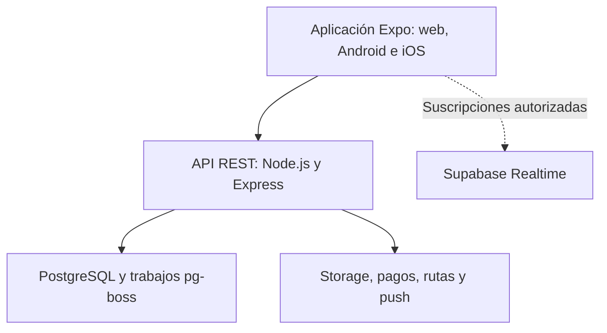

# Logitrak

Logitrak es una plataforma de logística de última milla que conecta a quienes necesitan enviar una carga con los choferes que pueden transportarla. Permite cotizar con Boxy, crear un pedido, pagarlo, asignarlo a un chofer y seguir sus avances hasta la entrega.

La aplicación comparte una base de código para **web, Android e iOS**, desarrollada con Expo, React Native y TypeScript. Consume una API REST de Node.js y Express, con PostgreSQL en Supabase.

| Servicio | Dirección o tecnología |
|---|---|
| Web App | [ccchimi.github.io/Logitrak](https://ccchimi.github.io/Logitrak/) — GitHub Pages |
| API | [logitrak.onrender.com](https://logitrak.onrender.com) — Render |
| Salud de la API | [GET /api/salud](https://logitrak.onrender.com/api/salud) |
| Base de datos | PostgreSQL en Supabase |
| Archivos privados | Supabase Storage, según configuración |
| Builds móviles | Expo Application Services (EAS Build) |

Estas direcciones corresponden a la configuración documentada del proyecto; su disponibilidad y las credenciales activas se verifican en cada entorno.

## Funcionalidades y roles

El sistema tiene cuatro roles. Los permisos efectivos se comprueban en el backend; ocultar una acción en la interfaz no reemplaza esa autorización.

| Rol | Acceso y funciones principales |
|---|---|
| `cliente` | Se registra en la aplicación. Cotiza con Boxy, crea y paga pedidos, consulta seguimiento, historial, cupones, notificaciones y soporte. |
| `chofer` | Se obtiene mediante la postulación y verificación de identidad. Consulta ofertas filtradas por peso y bultos de su vehículo, toma viajes, registra avances y confirma entregas. |
| `soporte` | Lo asigna un administrador. Accede al panel operativo, consulta envíos, usuarios, cotizaciones y pagos; atiende consultas y puede desbloquear un PIN de entrega. |
| `admin` | Las cuentas iniciales se siembran al arrancar; luego otro administrador puede asignar el rol. Tiene las capacidades de soporte y permisos adicionales sobre reembolsos, roles, documentación y mantenimiento. |

El panel del equipo incluye métricas, indicadores de las últimas 24 horas, consulta de pedidos y listado de usuarios con búsqueda, filtros y paginación. Los datos se obtienen de la API: los indicadores temporales y parte de los filtros de pedidos se calculan sobre la lista recuperada por el frontend. El listado de envíos tiene límites de consulta, por lo que no debe asumirse que toda visualización equivale a un histórico completo.

La aplicación también incluye una página pública de presentación, acceso y registro, recuperación de contraseña, Mi Perfil, preferencias de tema, notificaciones y formularios de postulación de choferes.

## Circuito de un envío

1. **Cotización.** Boxy interpreta direcciones y carga en el dispositivo y propone vehículo y tarifa. El backend recalcula el importe con una versión empaquetada del mismo cotizador; el precio del cliente no se acepta como autoridad.
2. **Pedido y pago.** Al confirmar se crea un envío pendiente, con vencimiento para el pago. El pago aprobado habilita la oferta para la flota.
3. **Asignación.** El envío se ofrece a choferes cuyos vehículos admiten el peso y la cantidad de bultos.
4. **Seguimiento.** El chofer registra hitos del viaje; el cliente consulta estados, datos del chofer, historial de eventos y una ruta en el mapa. El desplazamiento del marcador del chofer es una animación de demostración: no representa su ubicación GPS real. Realtime complementa las consultas periódicas de estados y eventos cuando está configurado.
5. **Entrega.** Se confirma mediante el PIN del receptor y una foto de comprobante. Hay un límite de intentos y un mecanismo de desbloqueo para soporte y administración.
6. **Eventos y avisos.** El servidor registra eventos en un outbox y los procesa para generar notificaciones y solicitar envíos push cuando corresponde.

Los estados principales de los envíos son `pendiente`, `asignado`, `en_viaje`, `entregado` y `cancelado`. El estado del pago se registra por separado.

### Pedidos impagos, falta de chofer y compensaciones

- **Pedido sin pagar:** el plazo predeterminado es de 5 minutos (`MINUTOS_PARA_PAGAR`). Después del vencimiento, la API rechaza nuevos pagos sobre ese pedido y un trabajo del servidor puede eliminarlo. La limpieza contempla un minuto de gracia, barridos periódicos y comprobación de pagos en curso; no ocurre necesariamente en el segundo exacto del vencimiento.
- **Pedido pagado sin chofer:** la oferta vence por defecto a los 5 minutos (`MINUTOS_ESPERA_CHOFER`). El servidor intenta reembolsarlo y registra el resultado. Un error de la pasarela puede requerir reintentos o revisión; la cancelación no garantiza por sí sola que el dinero ya haya sido devuelto.
- **SLA de retiro:** el plazo comprometido se calcula desde el pago, con el tiempo estimado de llegada al retiro y un margen urbano o interurbano. Si el retiro incumple ese plazo, el servidor puede acreditar un cupón del **10 %**, evitando duplicarlo. `MINUTOS_SLA` es un respaldo para cotizaciones sin estimación, no el plazo universal de todos los envíos.

Estas tareas viven en el backend y usan `pg-boss` sobre PostgreSQL. No dependen de mantener abierta la aplicación. Sí dependen de que los trabajos estén habilitados y el proceso del servidor esté activo; se realizan barridos al arrancar y periódicamente.

## Arquitectura y organización



| Ubicación | Responsabilidad |
|---|---|
| `frontend/App.tsx` | Entrada visual, fuentes, restauración de sesión y acceso a la aplicación. |
| `frontend/src/navigation/` | Navegación y selección de pantallas según sesión y permisos. |
| `frontend/src/screens/` | Pantallas públicas, de clientes, choferes y equipo operativo. |
| `frontend/src/components/` | Formularios, botones, modales, mapas, navegación compartida y componentes de Boxy y administración. |
| `frontend/src/services/` | Cliente HTTP, sesión, llamadas a la API, Realtime, push y almacenamiento local. |
| `frontend/src/services/botLogistica/` | Interpretación de carga y direcciones, conversación y cotización de Boxy. |
| `frontend/src/hooks/`, `theme/`, `styles/` | Preferencias, tema, movimiento reducido y estilos. |
| `frontend/assets/` | Fuentes, iconos, ilustraciones e imágenes. |
| `backend/src/index.js`, `app.js` | Arranque del servidor, montaje de rutas y manejo HTTP. |
| `backend/src/rutas/` | Recursos de la API. |
| `backend/src/middleware/`, `esquemas/` | Autenticación, permisos, límites, seguridad y validación de solicitudes. |
| `backend/src/servicios/` | Lógica de negocio, sesiones, pagos, identidad, almacenamiento y operaciones de envíos. |
| `backend/src/trabajos/`, `outbox/` | Vencimientos, revisión de SLA y procesamiento de eventos. |
| `backend/src/db/`, `migrations/` | Conexión, inicialización y evolución versionada de la base. |
| `backend/src/observabilidad/` | Logs con Pino e integración opcional con Sentry. |
| `docs/` | Informe técnico, planes de pruebas, mantenimiento y evolución. |
| `.github/workflows/` | Integración continua y publicación de la Web App. |

Las rutas principales de la API se agrupan bajo `/api/auth`, `/api/perfil`, `/api/choferes`, `/api/vehiculos`, `/api/cotizaciones`, `/api/envios`, `/api/asignaciones`, `/api/pagos`, `/api/cupones`, `/api/admin`, `/api/soporte`, `/api/recorridos` y `/api/notificaciones`. El detalle está en el [README del backend](backend/README.md).

La persistencia incluye usuarios, sesiones, choferes, vehículos, cotizaciones, envíos, asignaciones, eventos, pagos, cupones, soporte y notificaciones. Las migraciones son la referencia para la estructura de la base.

### Tecnologías principales

| Área | Tecnologías |
|---|---|
| Aplicación | Expo SDK 54, React Native 0.81.5, React 19.1 y TypeScript 5.9 |
| Navegación y web | React Navigation 7 y `react-native-web` |
| UI y recursos | Componentes propios, fuentes Poppins, Syne y DM Sans; Material Icons |
| Mapas y ubicación | `react-native-maps`, Google Maps JavaScript, Directions y `expo-location` |
| Identidad | `expo-camera`, ML Kit en móvil y comparación facial en backend |
| Persistencia local | AsyncStorage; las preferencias se guardan en el dispositivo o navegador |
| API y datos | Express 4, `pg`, PostgreSQL, `node-pg-migrate` y `pg-boss` |
| Sesiones y validación | JWT, `bcryptjs`, Zod, Helmet y `express-rate-limit` |
| Integraciones | Supabase, Mercado Pago, MODO y Expo Push |
| Observabilidad | Pino y Sentry opcional |
| Pruebas | Jest y `ts-jest` en frontend; `node:test` y Supertest en backend |

### Diferencias entre web y móvil

El mapa tiene implementaciones separadas: `MapaSeguimiento.tsx` para móvil y `MapaSeguimiento.web.tsx` para web. La ruta por calles del móvil se solicita a `GET /api/recorridos`; la clave de Directions del servidor no se entrega a la aplicación.

Los módulos nativos de detección facial y prueba de vida requieren un build de desarrollo compatible. No debe asumirse que el circuito completo de identidad funciona en web o Expo Go. Las notificaciones push nativas también necesitan dispositivo, permisos y credenciales de plataforma; el código omite su registro en web.

## Puesta en marcha

### Requisitos

- **Node.js 22.12.0 o superior**, según `backend/package.json`; los workflows usan Node 22.
- npm y Git.
- PostgreSQL propio o un entorno de desarrollo/staging de Supabase para ejecutar el backend.
- Herramientas nativas de Android o iOS si se va a generar un build local móvil.

Cloná el repositorio y entrá en su carpeta:

```bash
git clone https://github.com/ccchimi/Logitrak.git
cd Logitrak
```

### Trabajar solamente en frontend

No hace falta levantar ni modificar el backend si ya existe una API del equipo disponible para desarrollo.

```bash
cd frontend
npm ci
cp .env.example .env
```

Revisá `frontend/.env` y configurá `EXPO_PUBLIC_API_URL` con la API que corresponda. El ejemplo apunta a Render; las operaciones realizadas contra esa dirección usan los datos de ese entorno. Para pruebas que creen o modifiquen registros, usá una API y datos destinados a pruebas.

```bash
npm run web
```

Para iniciar Metro y elegir plataforma:

```bash
npm start
```

Los comandos `npm run android` y `npm run ios` generan y ejecutan builds nativos locales y requieren las herramientas de cada plataforma. Los perfiles de EAS están en [`frontend/eas.json`](frontend/eas.json).

### Ejecutar también el backend local

En otra terminal, desde la raíz del repositorio:

```bash
cd backend
npm ci
cp .env.example .env
```

Configurá `DATABASE_URL` con una base de desarrollo y definí un `JWT_SECRET` propio antes de arrancar:

```bash
npm run dev
```

**El arranque del backend aplica migraciones pendientes y siembra datos base.** No es una comprobación de solo lectura y no debe apuntarse a una base real para una prueba exploratoria. La API local usa por defecto el puerto `4000`.

Si el frontend corre en el navegador de la misma computadora, puede usar `http://localhost:4000`. Desde un teléfono físico, usá la IP LAN de la computadora con el puerto `4000`, o una API pública de pruebas. Reiniciá Expo cuando cambies las variables del bundle.

## Configuración

Los ejemplos completos están en [`backend/.env.example`](backend/.env.example) y [`frontend/.env.example`](frontend/.env.example). Los archivos con valores reales no se suben al repositorio.

### Backend

| Variable o grupo | Uso |
|---|---|
| `DATABASE_URL`, `JWT_SECRET` | Obligatorios para iniciar: conexión a PostgreSQL y firma de sesiones. |
| `PORT`, `PUBLIC_API_URL` | Puerto local y URL pública usada para callbacks. Render asigna `PORT`. |
| `ENTORNO` | `desarrollo`, `staging` o `produccion`. Por defecto se selecciona producción en Render o con `NODE_ENV=production`, y desarrollo en los demás casos. |
| `ACCESS_TOKEN_EXPIRA`, `REFRESH_TOKEN_DIAS`, `JWT_EXPIRA` | Acceso corto (por defecto 15 min), refresh renovable (30 días por token) y token de compatibilidad (8 h). |
| `PGSSL`, `PGSSL_STRICT` | Configuración SSL de la conexión a PostgreSQL. |
| `SUPABASE_URL`, `SUPABASE_SERVICE_ROLE_KEY`, `SUPABASE_BUCKET` | Storage privado para documentos y comprobantes. |
| `SUPABASE_ANON_KEY`, `SUPABASE_JWT_SECRET` | Junto con Supabase, habilitan las suscripciones Realtime autorizadas de la aplicación. |
| `MP_ACCESS_TOKEN`, `MP_WEBHOOK_SECRET` | Mercado Pago y validación de sus webhooks. Sin el secreto, los avisos del webhook se rechazan. |
| `MODO_API_URL`, `MODO_CLIENT_ID`, `MODO_CLIENT_SECRET`, `MODO_STORE_ID` | Integración con MODO; ver opciones adicionales en el ejemplo. |
| `RENAPER_API_URL`, `RENAPER_API_KEY` | Reservadas para RENAPER real, todavía pendiente de implementación. Configurar ambas selecciona un camino que lanza un error; la verificación vigente usa PDF417 y comprobaciones locales. |
| `MINUTOS_PARA_PAGAR`, `MINUTOS_ESPERA_CHOFER`, `MINUTOS_SLA` | Vencimiento de pago, espera por chofer y plazo de respaldo para SLA. |
| `TRABAJOS_DESHABILITADOS` | `true` desactiva los trabajos de `pg-boss`. |
| `GOOGLE_DIRECTIONS_KEY` | Clave de servidor para recorridos del móvil. |
| `EXPO_ACCESS_TOKEN` | Opcional, según la seguridad configurada para Expo Push. |
| `LOG_LEVEL`, `SENTRY_DSN` | Nivel de logs y reporte opcional de errores. |
| `CORS_ORIGENES`, `CORS_RED_LOCAL`, `TRUST_PROXY` | Orígenes web permitidos y configuración de proxy. |

Se cargan primero `.env.<entorno>` y después `.env`, sin reemplazar variables ya definidas. Los valores del entorno del proceso tienen prioridad. En Render, se administran desde la configuración del servicio.

El porcentaje de compensación actual proviene de `BONIFICACION_SLA_PCT` en el cotizador. No se configura mediante una variable de entorno `DESCUENTO_SLA_PCT`.

### Frontend y builds

| Variable | Uso |
|---|---|
| `EXPO_PUBLIC_API_URL` | URL base de la API. |
| `EXPO_PUBLIC_GOOGLE_MAPS_ANDROID_KEY` | Mapa nativo de Android. |
| `EXPO_PUBLIC_GOOGLE_MAPS_WEB_KEY` | Google Maps en web. |
| `EXPO_PUBLIC_SENTRY_DSN` | Reporte opcional de errores del cliente. |
| `EXPO_BASE_URL` | Prefijo de exportación web; el workflow de Pages usa `/Logitrak`. |
| `GOOGLE_SERVICES_JSON` | Archivo de configuración de Firebase para builds Android, si se utiliza. |
| `SENTRY_AUTH_TOKEN`, `SENTRY_ORG`, `SENTRY_PROJECT` | Integración de Sentry en el build cuando está configurada. No son variables públicas de la app. |

Las variables `EXPO_PUBLIC_*` quedan incorporadas en el cliente: nunca deben contener secretos de servidor. Las claves de Maps deben restringirse a las APIs, dominios o aplicaciones correspondientes. Las credenciales de Firebase, APNs y EAS se administran por los mecanismos de cada plataforma; no deben publicarse claves privadas.

La publicación web toma variables y secretos de GitHub Actions. Los builds de EAS requieren su propia configuración de entorno; no se debe asumir que heredan las variables configuradas en Render.

## Pagos: qué es real y qué es simulado

| Método | Implementación actual |
|---|---|
| Mercado Pago | Integración con checkout, consulta de estado y webhook firmado. Usa sandbox local si no hay token; el tipo de credenciales del proveedor determina si hay cobros reales. |
| MODO | Integración configurable en servicios y API; no aparece como método independiente en la pantalla de pago. Sin configuración se utiliza un circuito simulado. |
| Tarjeta ingresada directamente en Logitrak | **Procesador simulado:** valida datos y genera un resultado de prueba. No es una integración bancaria ni un cobro real de tarjeta. |

Los endpoints de inicio de pago admiten `Idempotency-Key`; el frontend conserva la clave de una operación cuando debe reintentar por falta de conexión. Esto reduce duplicados por reintentos, pero no reemplaza la conciliación de pagos aprobados por vías distintas.

No se deben ingresar datos reales de tarjetas en el procesador simulado. Para cobrar tarjetas de verdad se necesita integrar un proveedor que tokenice los datos del lado del cliente. Los reembolsos reales y las notificaciones de proveedores requieren validación específica del entorno; la existencia del código no certifica su funcionamiento productivo.

## Sesiones, Mi Perfil y preferencias

La aplicación utiliza JWT de acceso y refresh tokens rotativos y revocables. El backend guarda hashes de refresh tokens y contempla detección de reutilización. El cliente persiste la sesión con AsyncStorage; el uso de almacenamiento seguro nativo para el refresh token sigue pendiente.

En Mi Perfil:

- El cambio de contraseña comprueba la contraseña actual en el backend.
- El frontend puede comprobar credenciales usando login con el encabezado de verificación, sin abrir una sesión nueva. Esa comprobación no emite una autorización reutilizable para editar otros campos.
- La edición individual de los demás datos está limitada en la interfaz; email y teléfono están deshabilitados. No debe presentarse como una edición completa ya habilitada.
- El backend admite algunos cambios de perfil, pero todavía no vincula cada cambio sensible con una autorización de reautenticación específica; el nombre de usuario no se modifica mediante ese contrato.
- La eliminación de cuenta solicita contraseña y está sujeta a restricciones por rol y operaciones activas. El backend anonimiza datos y conserva los comprobantes previstos por su implementación.
- El tema claro/oscuro y el modo silencioso se conservan localmente. No son preferencias sincronizadas con el servidor. El modo silencioso no está integrado de forma global con el sonido de las notificaciones push.

La recuperación de contraseña existe, pero su verificación de identidad necesita reforzarse antes de considerarla un mecanismo seguro para producción.

## Pruebas y calidad

Desde `frontend/`:

```bash
npm run typecheck
npm test -- --runInBand
npm run test:coverage -- --ci
npm run build:web
npm run verify:backend
```

`verify:backend` consulta la salud de la API configurada. No comprueba login, pagos ni el circuito completo de un envío. La cobertura de Jest se mide actualmente sobre los módulos de tarifas, cargas, direcciones y NLP definidos en `jest.config.js`, no sobre todas las pantallas.

Desde `backend/`, con dependencias instaladas:

```bash
npm test
npm run test:cobertura
```

Las pruebas que necesitan PostgreSQL deben usar `TEST_DATABASE_URL` con una base descartable. Sin esa configuración, parte de las pruebas de integración se omite. No se debe reutilizar la base operativa para ejecutar pruebas.

La [CI](.github/workflows/ci.yml) ejecuta pruebas y cobertura de frontend y backend, verifica que el cotizador empaquetado esté actualizado y utiliza PostgreSQL descartable para integración. Se activa con push y pull requests a `main`, semanalmente y de forma manual. La publicación web está en un [workflow separado](.github/workflows/web.yml).

Los resultados y la cantidad de pruebas de cada ejecución están disponibles en el [historial de CI de GitHub Actions](https://github.com/ccchimi/Logitrak/actions/workflows/ci.yml).

## Despliegue y operación

- **Frontend web:** GitHub Actions instala dependencias, exporta Expo y publica `frontend/dist` en GitHub Pages cuando cambian los archivos definidos por el workflow en `main`.
- **Backend:** Render ejecuta la API. El repositorio documenta `npm install` y `npm start`; la configuración efectiva de despliegue automático se verifica en el panel de Render.
- **Base y archivos:** PostgreSQL y Storage privado en Supabase. Las migraciones se aplican durante el arranque del backend.
- **Móvil:** EAS Build utiliza los perfiles `development`, `preview` y `production`. El perfil `preview` es un perfil de compilación interna, no una vista previa local que evite la autenticación.
- **Salud:** `GET /api/salud/vivo` verifica que el proceso responde; `GET /api/salud` informa preparación y estado de la base y componentes. Ninguno reemplaza pruebas funcionales.
- **Observabilidad:** logs estructurados con Pino, identificador de solicitud y reporte opcional a Sentry. La configuración de Sentry y el envío de símbolos requieren credenciales del entorno correspondiente.

El repositorio documenta el uso de Render Free. Cuando el servicio está detenido por inactividad o reiniciándose, el primer acceso puede demorarse y los trabajos de fondo no se ejecutan hasta que el proceso vuelva a estar activo. Para necesidades productivas, debe evaluarse la disponibilidad requerida del servicio y de sus integraciones.

## Limitaciones y trabajo pendiente

Además de las restricciones de Mi Perfil y pagos ya descritas:

- Los cupones se acreditan y consultan, pero aún no se aplican al pago de un nuevo envío.
- Guardar tarjetas o cuentas de cobro desde las pantallas de métodos está pendiente; esas pantallas no persisten los datos ingresados.
- El listado de envíos devuelve hasta 200 registros por consulta. El panel intenta ampliar por estado, pero esto no sustituye una API con paginación e históricos completos.
- Listar usuarios y cambiar roles no equivale a editar los perfiles completos de otras personas.
- La compatibilidad y configuración de identidad, mapas y push deben validarse por plataforma. El despliegue iOS necesita sus credenciales específicas.
- Las notificaciones por correo no están implementadas como canal general; el registro de clientes no pide email.
- El código de recuperación y la inicialización de cuentas administrativas requieren revisión de seguridad antes de un uso productivo.
- La inteligencia logística predictiva descrita en el roadmap es una evolución propuesta, no una capacidad ya implementada de Boxy.

Consultá los [pendientes técnicos](docs/pendientes-logitrak.md) y el [roadmap](docs/ROADMAP.md). Esos documentos pueden contener referencias históricas: ante diferencias, debe contrastarse cada punto con el código y la configuración desplegada.

## Documentación relacionada

- [Backend: configuración, endpoints y operación](backend/README.md).
- [Frontend: aplicación y estructura](frontend/README.md).
- [Mobile App: instalación, configuración y builds Android/iOS](docs/mobile/README.md).
- [Recursos gráficos y fuentes](frontend/assets/README.md).
- [Informe técnico del Parcial 2](docs/informe-tecnico-parcial-2.md).
- [Plan de pruebas](docs/qa/plan-de-pruebas-cotizador.md).
- [Pruebas unitarias](docs/qa/pruebas-unitarias.md).
- [Plan de mantenimiento](docs/qa/plan-de-mantenimiento.md).
- [Propuesta de inteligencia logística predictiva](docs/MODULO-IA-PREDICTIVA.md).

`node_modules/` contiene dependencias instaladas y `frontend/dist/` la exportación web generada. Ambas están excluidas por las reglas de Git; se regeneran a partir del código y los archivos de dependencias.

---

© 2026 Logitrak. Todos los derechos reservados.
