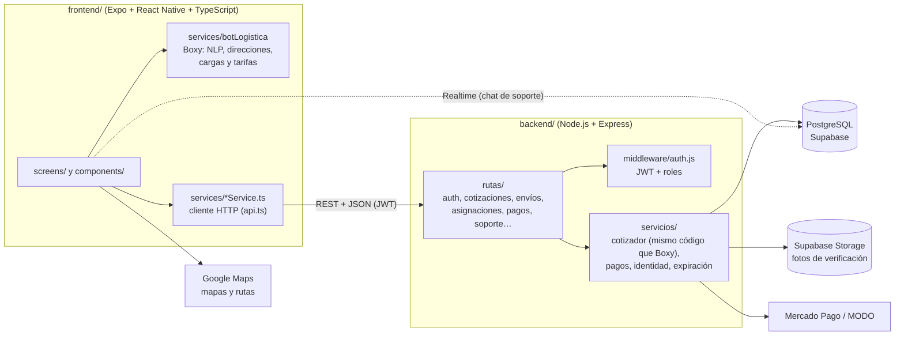

# Logitrak

Logitrak es una plataforma de logística de última milla que conecta a quien
necesita enviar algo con la flota que puede llevarlo. El cliente cotiza su envío
conversando con un asistente, lo paga, y a partir de ahí lo sigue en un mapa
hasta que llega a destino.

La idea detrás del proyecto es que mandar un paquete debería ser tan simple como
pedir un viaje. Para eso nos apoyamos en tres decisiones que atraviesan todo el
sistema. La primera es que el precio se explica: en lugar de mostrar una tarifa
cerrada, el motor de cotización desglosa cuánto pesa el vehículo elegido, la
distancia, el peso volumétrico y la franja horaria. La segunda es que la
confianza se construye con datos verificables, así que los choferes pasan por una
verificación de identidad y el cliente ve en todo momento quién lleva su carga y
en qué unidad. La tercera es que la misma aplicación corre en web, Android e iOS
desde una única base de código, para no mantener tres productos distintos.

## Cómo funciona el circuito

El cliente arranca cotizando con Boxy, el asistente que corre en el propio
dispositivo: interpreta las direcciones y la descripción de la carga, elige el
vehículo que corresponde y arma el precio. Cuando confirma y paga, el envío deja
de ser una cotización y pasa a estar disponible para la flota.

Ahí entra el modelo que usamos para asignar: el envío pagado se publica para
todos los choferes cuyo vehículo puede transportar esa carga, y el primero que lo
toma se lo queda. Es el mismo esquema de las aplicaciones de movilidad, y nos
evita tener que decidir centralmente a quién le toca cada viaje. Desde ese
momento el cliente ve el nombre del chofer, su identificador y la unidad real que
salió a buscar el paquete, mientras el chofer va marcando los hitos del viaje
desde su propia consola.

Si el envío supera el plazo comprometido, se emite un cupón de compensación a
favor del cliente. Conviene aclarar que hoy ese cupón se dispara desde la
aplicación cuando vence el contador, y no desde un proceso en el servidor: es una
deuda que tenemos pendiente y está anotada como tal.

El sistema maneja tres roles. Cliente es cualquiera que se registra. Chofer es un
cliente que se postuló, declaró con qué vehículo trabaja y aprobó la verificación
de identidad. Admin se siembra por sistema y no puede crearse desde la
aplicación.

## Cómo está organizado el repositorio

El proyecto se divide en dos partes que se desarrollan y se despliegan por
separado.

En `backend/` vive la API REST, escrita en Node.js con Express sobre PostgreSQL.
Resuelve la autenticación con roles, las cotizaciones, los envíos y su
seguimiento, la asignación a choferes, los pagos, los cupones y la verificación
de identidad.

En `frontend/` está la aplicación, hecha con Expo y React Native en TypeScript.
Incluye a Boxy, el mapa de seguimiento, el circuito de pago y el alta de chofer.

Cada carpeta tiene su propio README con el detalle de configuración: el de
[`backend/`](backend/README.md) para la API y el de [`frontend/`](frontend/README.md),
que es el README específico de la aplicación mobile. El orden para levantar el
proyecto es siempre el mismo: primero el backend apuntado a la base del equipo, y
después el frontend apuntado a esa API.

### Web App y Mobile App

La Web App está publicada en **https://ccchimi.github.io/Logitrak/** y la API en
**https://logitrak.onrender.com**. La Web App y la Mobile App salen del mismo código de `frontend/`. Expo compila
las pantallas de React Native a Android e iOS, y con `react-native-web` a una
aplicación web. Las dos hablan con el mismo backend, así que la Web App completa
es `frontend/` (en modo web) más `backend/`. Las diferencias por plataforma están
resueltas dentro del código: el mapa tiene una versión web propia
(`MapaSeguimiento.web.tsx`, con la API JavaScript de Google Maps) y la prueba de
vida de la verificación de identidad solo corre en el teléfono, porque necesita
la cámara y módulos nativos.

## Arquitectura



Es una arquitectura cliente-servidor en capas. En la app, las pantallas
(`screens/`) se apoyan en componentes reutilizables (`components/`) y nunca llaman
a la red directamente: lo hacen a través de los servicios de `services/`, que
comparten un único cliente HTTP con la URL base y el token. Boxy corre en el
dispositivo para responder al instante, pero el precio que vale es el que
recalcula el backend con el mismo código (ver
[`backend/README.md`](backend/README.md#cómo-se-calcula-el-precio)).

En el backend, cada recurso tiene su archivo en `rutas/`, la autenticación y los
permisos por rol están en `middleware/`, y la lógica que no es HTTP (cotizador,
pasarelas de pago, verificación de identidad, expiración de ofertas) vive en
`servicios/`. Todas las consultas a PostgreSQL van parametrizadas.

## Variables de entorno

Cada parte tiene su `.env.example` comentado línea por línea. Se copia a `.env`,
que está en `.gitignore`, y se completa. En producción las variables se cargan
en el panel de Render (backend) y en EAS (builds de la app), no en archivos.

**Backend** (`backend/.env`)

| Variable | Obligatoria | Para qué sirve |
|---|---|---|
| `DATABASE_URL` | Sí | Conexión a PostgreSQL (Supabase, *session pooler*) |
| `JWT_SECRET` | Sí | Firma de los tokens de sesión |
| `ACCESS_TOKEN_EXPIRA` | No | Duración del token de acceso de la app (por defecto `15m`) |
| `REFRESH_TOKEN_DIAS` | No | Días que dura el refresh token sin usarse (por defecto `30`) |
| `JWT_EXPIRA` | No | Token largo para versiones viejas de la app que no renuevan (por defecto `8h`) |
| `PORT` | No | Puerto de la API en local (por defecto `4000`) |
| `PUBLIC_API_URL` | No | URL pública del backend, para los callbacks de pago |
| `SUPABASE_URL`, `SUPABASE_SERVICE_ROLE_KEY`, `SUPABASE_BUCKET` | No | Bucket privado para las fotos de verificación |
| `SUPABASE_ANON_KEY`, `SUPABASE_JWT_SECRET` | No | Chat de soporte en tiempo real |
| `MP_ACCESS_TOKEN` | No | Mercado Pago (vacío = sandbox simulado) |
| `MODO_API_URL`, `MODO_CLIENT_ID`, `MODO_CLIENT_SECRET`, `MODO_STORE_ID` | No | MODO (vacío = sandbox simulado) |
| `RENAPER_API_URL`, `RENAPER_API_KEY` | No | Verificación contra RENAPER (vacío = lectura offline del DNI) |
| `MINUTOS_ESPERA_CHOFER` | No | Minutos que espera un envío pago a que lo tome un chofer (5) |

**Frontend** (`frontend/.env`)

| Variable | Obligatoria | Para qué sirve |
|---|---|---|
| `EXPO_PUBLIC_API_URL` | Sí | URL del backend (en local, la IP LAN de la PC, no `localhost`) |
| `EXPO_PUBLIC_GOOGLE_MAPS_ANDROID_KEY` | Para mapas | Mapa nativo en Android |
| `EXPO_PUBLIC_GOOGLE_DIRECTIONS_KEY` | Para mapas | Trazado de rutas |
| `EXPO_PUBLIC_GOOGLE_MAPS_WEB_KEY` | Para mapas | Mapa de la versión web |

Todo lo que empieza con `EXPO_PUBLIC_` queda dentro de la app, así que ahí nunca
van secretos de servidor.

## Librerías principales

| Parte | Librería | Uso |
|---|---|---|
| App | Expo SDK 54, React Native 0.81, React 19 | Base de la aplicación mobile y web |
| App | `react-native-web` | Versión web desde el mismo código |
| App | React Navigation (`native-stack`) | Navegación entre pantallas |
| App | `react-native-maps`, `react-native-maps-directions` | Mapa y ruta del seguimiento |
| App | `expo-location` | Ubicación del chofer |
| App | `expo-camera`, `@react-native-ml-kit/face-detection` | Escaneo de DNI, selfie y prueba de vida |
| App | `@supabase/supabase-js` | Chat de soporte en tiempo real |
| App | `@react-native-async-storage/async-storage` | Sesión guardada en el dispositivo |
| API | Express 4 | Servidor HTTP y rutas REST |
| API | `pg` | Acceso a PostgreSQL |
| API | `jsonwebtoken`, `bcryptjs` | Sesiones con JWT y contraseñas hasheadas |
| API | `express-rate-limit` | Límite de intentos en login y recuperación |
| API | `mercadopago`, `qrcode` | Cobros con Mercado Pago y pagos por QR |
| API | `@supabase/supabase-js` | Storage privado de las fotos de verificación |
| API | `@vladmandic/face-api`, `jpeg-js` | Comparación facial de la selfie con el DNI |
| Calidad | Jest + `ts-jest`, `node:test`, esbuild | Pruebas del cotizador y del backend; empaquetado del cotizador para el servidor |

## Puesta en marcha

```bash
# 1) Backend
cd backend && npm install
cp .env.example .env        # pegá el DATABASE_URL del proyecto de Supabase
npm run dev                 # API en http://localhost:4000

# 2) Frontend (en otra terminal)
cd frontend && npm install
cp .env.example .env        # fijá EXPO_PUBLIC_API_URL a la IP LAN de tu backend
npm start                   # escaneá el QR con Expo Go o elegí plataforma
npm run web                 # o directamente la Web App en el navegador
```

Hace falta Node.js 20 o superior. Para la app en el teléfono alcanza con Expo Go;
la prueba de vida de la verificación de identidad necesita un dev build
(`npx expo run:android`).

## Pruebas y calidad

```bash
cd frontend && npm test     # 107 pruebas del cotizador (Jest), con cobertura: npm run test:coverage
cd backend && npm test      # pruebas del cálculo de precio en el servidor (node --test)
```

Las dos baterías corren solas en GitHub Actions en cada push a `main`
(`.github/workflows/ci.yml`). El plan de pruebas y el de mantenimiento están en
[`docs/qa/`](docs/qa/), y las tareas pendientes en
[`docs/pendientes-logitrak.md`](docs/pendientes-logitrak.md).

## Dónde corre

El backend está desplegado en Render como Web Service, con despliegue automático
desde `main`, y responde en `https://logitrak.onrender.com`. La base de datos es
un PostgreSQL gestionado en Supabase, que además nos guarda en un bucket privado
las fotos de la verificación de identidad. La aplicación se compila con EAS
Build, que es el servicio de builds de Expo.

Una limitación a tener presente: el plan gratuito de Render apaga la instancia
cuando no recibe tráfico, así que el primer pedido después de un rato puede
demorar cerca de cincuenta segundos. Para producción hace falta un plan que
mantenga el servicio siempre activo.

---

© 2026 Logitrak. Todos los derechos reservados.
