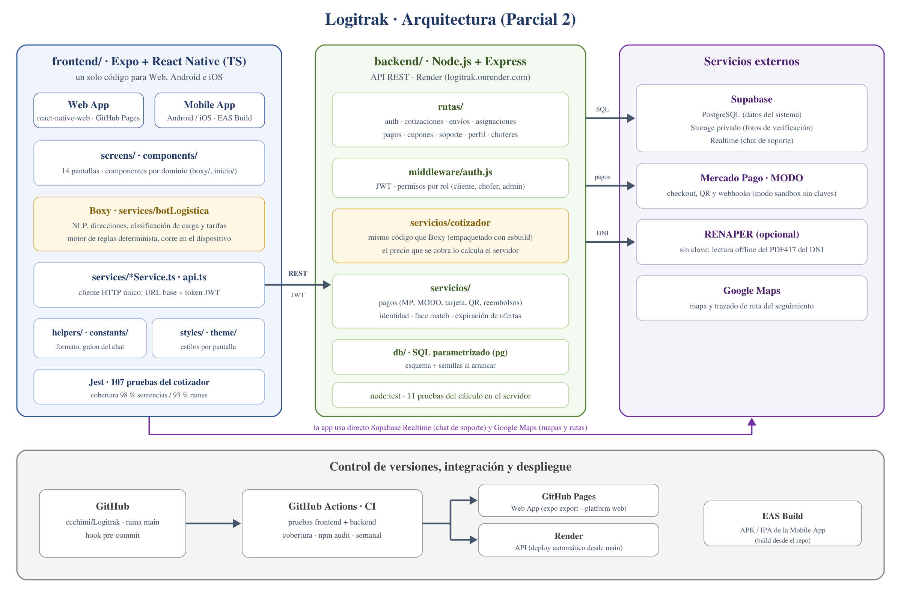

# Informe técnico — Parcial 2 (Seminario Final)

> Logitrak · entrega del repositorio de código (Web App + Mobile App). La versión
> en Word para entregar se genera a partir de este archivo.

## Enlaces de la entrega

| Recurso | Dirección |
|---|---|
| Repositorio (público) | https://github.com/ccchimi/Logitrak |
| Web App | https://ccchimi.github.io/Logitrak/ |
| API (backend) | https://logitrak.onrender.com/api/salud |
| Integración continua | https://github.com/ccchimi/Logitrak/actions |

La Mobile App se ejecuta con Expo Go (`npm start` en `frontend/`) o con un build de EAS. Las instrucciones de instalación están en el `README.md` de la raíz y en el `README.md` de cada parte (`frontend/` es el README específico de la app mobile).

## 1. Descripción técnica general del avance

Logitrak pasó del diseño del Parcial 1 a un sistema que funciona de punta a punta. Un cliente puede registrarse, cotizar un envío conversando con Boxy, confirmarlo, pagarlo y seguirlo en el mapa. Un chofer verificado ve los envíos compatibles con su vehículo, toma uno y marca los hitos del viaje. El administrador supervisa los envíos y puede reembolsarlos o archivarlos.

El repositorio está dividido en dos partes que se despliegan por separado:

- **`frontend/`**: aplicación en **Expo + React Native con TypeScript**. Con un mismo código se compila la **Mobile App** (Android e iOS) y la **Web App** (con `react-native-web`). Tiene 14 pantallas organizadas por capas: `screens/`, `components/`, `services/`, `helpers/`, `constants/`, `styles/` y `navigation/`.
- **`backend/`**: **API REST en Node.js + Express** sobre **PostgreSQL** (Supabase). Tiene 11 grupos de rutas (autenticación, cotizaciones, envíos, asignaciones, pagos, cupones, soporte, perfil, choferes, vehículos y administración), autenticación con JWT y permisos por rol.

Estado de los módulos:

| Módulo | Estado |
|---|---|
| Registro, login, recuperación de contraseña y roles (cliente, chofer, admin) | Implementado |
| Cotización con Boxy (direcciones, tipo de carga, vehículo y precio desglosado) | Implementado; el precio lo valida el servidor |
| Creación de envíos y código de seguimiento `TRK-AAAA-NNNNNN` | Implementado |
| Pagos: Mercado Pago (checkout, QR, webhook), MODO y tarjeta | Implementado; sin claves corre en modo sandbox |
| Asignación al primer chofer compatible que acepta, con vencimiento y reembolso automático | Implementado |
| Seguimiento con mapa, ruta, línea de tiempo, chofer y vehículo | Implementado (actualización periódica) |
| Postulación de chofer y verificación de identidad (DNI, selfie, prueba de vida opcional) | Implementado |
| Historial, perfil y cupones por SLA incumplido | Implementado |
| Soporte: tickets, chat en tiempo real y bot de soporte | Implementado (no estaba en el diseño) |
| Panel de administración | Parcial: métricas, reembolso y archivo de envíos; falta gestionar usuarios |

**Calidad.** Hay 118 pruebas automáticas: 107 del cotizador en Jest (98 % de cobertura de sentencias) y 11 del cálculo de precio en el servidor (`node:test`). Las dos baterías corren en **GitHub Actions** en cada push a `main`, junto con una auditoría de dependencias. Un segundo workflow publica la Web App en GitHub Pages.

## 2. Decisiones tecnológicas tomadas

| Decisión | Alternativas evaluadas | Por qué |
|---|---|---|
| **Expo + React Native + TypeScript** para web y mobile | Flutter; React (web) + Kotlin (Android) por separado | Un solo código para las tres plataformas, que era un objetivo del diseño. TypeScript detecta errores de tipos antes de ejecutar. |
| **Node.js + Express** para la API | Spring Boot, Django | El mismo lenguaje en todo el proyecto, y así el backend puede reutilizar el cotizador de la app sin reescribirlo. |
| **PostgreSQL en Supabase** | MongoDB, MySQL local | Datos relacionales (usuarios, envíos, pagos, asignaciones) con transacciones y bloqueos para que dos choferes no tomen el mismo envío. Supabase suma Storage privado y Realtime en el plan gratuito. |
| **SQL parametrizado con `pg`**, sin ORM | Prisma, Sequelize | Control total de las consultas con bloqueo (`FOR UPDATE`) y nada de superficie para inyección SQL. |
| **JWT + bcrypt + rate limiting** | Sesiones en servidor, Supabase Auth | API sin estado, fácil de consumir desde web y mobile; roles dentro del token. |
| **Boxy como motor de reglas** que corre en el dispositivo | Un modelo de lenguaje (LLM) externo | El precio tiene que ser explicable y reproducible: ante la misma entrada da siempre lo mismo y no puede inventar una tarifa. Además responde al instante y no manda domicilios a terceros. |
| **El servidor recalcula el precio** con el mismo código de Boxy (empaquetado con esbuild) | Confiar en el precio que manda la app | Evita que un cliente modifique el pedido y pague menos (defecto DEF-02, corregido en esta etapa). |
| **Mercado Pago y MODO** con modo sandbox | Solo Mercado Pago | Son los medios de pago más usados en Argentina. El modo sandbox deja probar todo el circuito sin cobrar. |
| **Render** (API), **GitHub Pages** (Web App) y **EAS Build** (Mobile App) | Un VPS propio | Despliegue automático desde GitHub y planes gratuitos suficientes para la etapa académica. |
| **Jest**, **`node:test`** y **GitHub Actions** | Pruebas manuales | Pruebas de regresión automáticas en cada cambio (ver TP de Calidad de Software). |

## 3. Cambios respecto al diseño inicial

| Diseño del Parcial 1 | Implementación actual | Motivo |
|---|---|---|
| RF04: Boxy como "IA" que recomienda el pedido | Motor de reglas con procesamiento de lenguaje: entiende direcciones, pesos con unidades y respuestas de sí/no, y clasifica la carga | Un precio no puede depender de un modelo que puede equivocarse o variar. Las reglas se pueden probar y explicar. |
| RF10: asignación de chofer automática mediante IA | El envío pagado se ofrece a todos los choferes con vehículo compatible y lo toma el primero que acepta. Si nadie lo toma en 5 minutos, se cancela y se reembolsa. | Es el modelo de las apps de movilidad: más simple, justo y sin una decisión central opaca. La asignación inteligente queda como evolución (ver `docs/ROADMAP.md`). |
| RF06: pagos con Mercado Pago | Mercado Pago, MODO, tarjeta y QR, con reembolsos | Más medios de pago y la necesidad de devolver el dinero cuando ningún chofer toma el envío. |
| RF11: seguimiento en tiempo real | El mapa y la línea de tiempo se actualizan consultando la API cada pocos segundos | El tiempo real por push ya funciona en el chat de soporte; pasarlo al seguimiento está planificado. |
| RF13: comunicación entre cliente y conductor | El cliente ve el nombre, el teléfono, el identificador y el vehículo del chofer. El chat es con soporte (bot + administrador), no directo con el chofer. | Se priorizó un canal de soporte supervisado. El chat directo queda pendiente. |
| RF09: cancelar envíos desde la app | La cancelación es automática si ningún chofer toma el envío, y el administrador puede reembolsar o archivar | Falta el botón de cancelación del lado del cliente. |
| RF14 (emails con comprobante) y RF16 (valoraciones) | No implementados | Se priorizó el circuito principal (cotizar, pagar, asignar, seguir). Quedan para la siguiente etapa. |
| RF17: panel de administración | El rol admin ve todos los envíos y métricas, reembolsa, archiva y atiende tickets de soporte | Falta la gestión de usuarios y choferes desde la interfaz. |
| Panel del chofer con interruptor Online/Offline | La consola del chofer muestra si está disponible y las ofertas compatibles; no hay un interruptor manual | Se simplificó: el chofer recibe ofertas mientras tiene la consola abierta. |
| Postulación de chofer solo en mobile | También se puede iniciar desde la web; la prueba de vida y el escaneo funcionan mejor en el teléfono | Para no bloquear el alta desde una computadora. |
| CU-14: compensación por SLA a cargo del sistema | El cupón se emite cuando vence el plazo, pero el disparo hoy está en la app | Deuda técnica registrada: pasarlo a un proceso del servidor. |
| — | Módulo de soporte con tickets, chat en tiempo real (Supabase Realtime) y bot | Surgió en el desarrollo para atender reclamos sin salir de la app. |
| — | El servidor recalcula y valida todas las cotizaciones | Hallazgo de seguridad en las pruebas (DEF-02). |

## 4. Diagrama actualizado de arquitectura

La arquitectura es cliente-servidor en capas. La app (web y mobile) no accede a la base de datos para operar: todo pasa por la API REST con un token JWT. El backend es el único que habla con PostgreSQL, con las pasarelas de pago y con RENAPER. Las dos excepciones son de lectura: el mapa de Google Maps y el chat de soporte en tiempo real, que la app escucha directamente en Supabase con un token de solo lectura firmado por el backend. Boxy existe en los dos lados con el mismo código: en la app para responder al instante y en el servidor para decidir el precio que se cobra.

## 5. Responsabilidades individuales

| Integrante | Rol | Responsabilidades en esta etapa |
|---|---|---|
| Franco Martin Schimizzi | Desarrollador Backend | API REST en Express, modelo de datos en PostgreSQL/Supabase, autenticación con JWT y roles, pagos y reembolsos (Mercado Pago, MODO), asignación y vencimiento de envíos, verificación de identidad del lado del servidor, despliegue en Render, integración continua y corrección de DEF-02. |
| Melina Rocio Martins | Desarrolladora Frontend / UX-UI | Prototipos web y mobile, sistema visual (paleta, tipografías, estilos), landing, panel del cliente, chat con Boxy, seguimiento y perfil. |
| Claudio Kevin Oturakdjian | Desarrollador Frontend / QA tester | Pantallas del chofer, pago e historial, flujo de postulación y escaneo de identidad, pruebas unitarias del cotizador, plan de pruebas y verificación de los circuitos en web y mobile. |
| Candela Analia Nuñez | Gestión del proyecto | Planificación y seguimiento de tareas, relevamiento de requerimientos y casos de uso, coordinación de entregas, documentación (READMEs, informes) y control de cambios respecto al diseño. |
