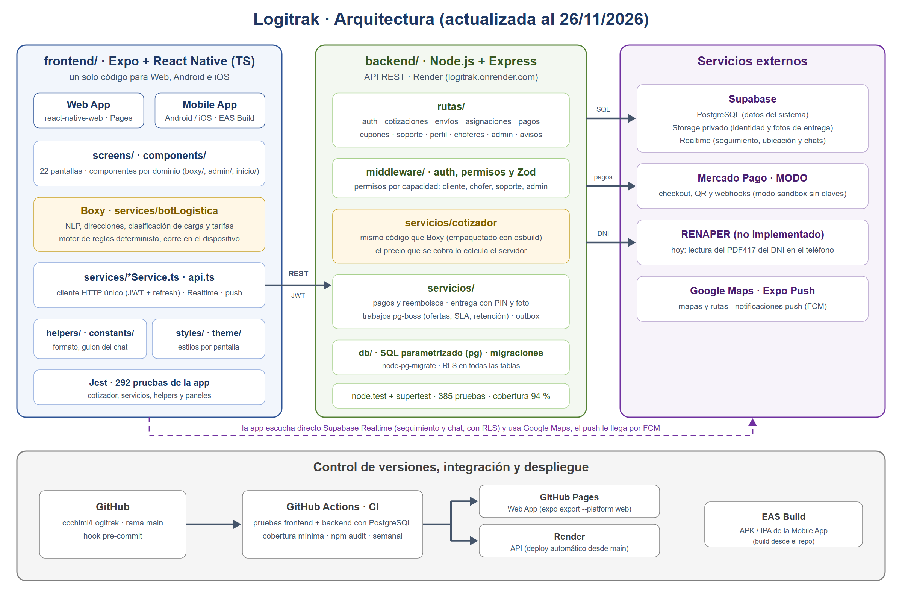

# Informe técnico — Parcial 2 (Seminario Final)

> Logitrak · entrega del repositorio de código (Web App + Mobile App). La versión
> en Word para entregar se genera a partir de este archivo.

**Proyecto:** Logitrak, plataforma de logística de última milla (Web App + Mobile App).

**Escuela Da Vinci** · Analista en Sistemas · Docente: Emmanuel Bruno · 2026

**Integrantes:** Franco Martin Schimizzi, Claudio Kevin Oturakdjian, Melina Rocio Martins, Candela Analia Nuñez

**Versión actualizada:** 26 de noviembre de 2026. La entrega original es del 2 de noviembre; esta versión refleja el estado actual del repositorio.

## Enlaces de la entrega

| Recurso | Dirección |
|---|---|
| Repositorio (público) | https://github.com/ccchimi/Logitrak |
| Web App | https://ccchimi.github.io/Logitrak/ |
| API (backend) | https://logitrak.onrender.com/api/salud |
| Integración continua | https://github.com/ccchimi/Logitrak/actions |

Qué integraciones son reales, cuáles funcionan con credenciales de prueba y cuáles están simuladas o pendientes se detalla en `docs/integraciones.md`; el tratamiento de los datos personales, en `docs/politica-de-datos.md`.

La Mobile App se ejecuta con un build de desarrollo de Expo (`npm run android` en `frontend/`) o con un build de EAS. Las instrucciones de instalación están en el `README.md` de la raíz, en `frontend/README.md` (Web App) y en `docs/mobile/README.md`, el README específico de la Mobile App para Android e iOS.

## 1. Descripción técnica general del avance

Logitrak pasó del diseño del Parcial 1 a un sistema que funciona de punta a punta y está desplegado. Un cliente puede registrarse, cotizar un envío conversando con Boxy, confirmarlo, pagarlo y seguir en tiempo real los estados y eventos del envío, con la ruta y la ubicación del chofer en el mapa, avisos dentro de la app y notificaciones push. Un chofer verificado ve los envíos compatibles con su vehículo, toma uno, marca los hitos del viaje y cierra la entrega con el PIN que le da quien recibe y una foto de comprobante. El equipo de soporte atiende consultas y supervisa la operación; el administrador además reembolsa, archiva envíos y asigna los roles de los usuarios.

El repositorio está dividido en dos partes que se despliegan por separado:

- **`frontend/`**: aplicación en **Expo + React Native con TypeScript**. Con un mismo código se compila la **Mobile App** (Android e iOS) y la **Web App** (con `react-native-web`). Tiene 22 pantallas organizadas por capas: `screens/`, `components/`, `services/`, `helpers/`, `constants/`, `styles/` y `navigation/`.
- **`backend/`**: **API REST en Node.js + Express** sobre **PostgreSQL** (Supabase). Tiene 15 grupos de rutas (autenticación, verificación en dos pasos, cotizaciones, envíos, chat del envío, asignaciones, pagos, cupones, soporte, perfil, choferes, vehículos, notificaciones, recorridos y administración) y un chequeo de salud, autenticación con JWT y refresh token, permisos por capacidad para cuatro roles, migraciones versionadas y trabajos en segundo plano.

Estado de los módulos:

| Módulo | Estado |
|---|---|
| Registro, login, recuperación de contraseña y roles (cliente, chofer, soporte, admin) | Implementado; sesiones con refresh token revocable y verificación en dos pasos (TOTP) para el equipo. La recuperación la resuelve soporte: verifica la identidad por el contacto del pedido y genera una contraseña temporal que vence en 24 horas y obliga a elegir una nueva |
| Cotización con Boxy (direcciones, tipo de carga, vehículo y precio desglosado) | Implementado; el precio lo valida el servidor |
| Creación de envíos y código de seguimiento `TRK-AAAA-NNNNNN` | Implementado |
| Pagos: Mercado Pago (checkout, QR, webhook), MODO y tarjeta | Implementado; sin claves corre en modo sandbox. Si un envío se cobra dos veces, el segundo pago se devuelve solo |
| Asignación al primer chofer compatible que acepta, con vencimiento y reembolso automático | Implementado: el vehículo se valida con las mismas reglas que la cotización (peso facturable, bultos, volumen y capacidad especial) y cada chofer lleva un envío a la vez |
| Seguimiento con mapa, ruta, línea de tiempo, chofer y vehículo | Implementado: estados, eventos y ubicación GPS del chofer en tiempo real con Supabase Realtime |
| Postulación de chofer y verificación de identidad (DNI, selfie, prueba de vida opcional) | Implementado |
| Historial paginado con búsqueda, perfil, descarga y eliminación de la cuenta, y cupones por SLA incumplido | Implementado; el SLA lo controla el servidor, los cupones vencen a los 90 días y se avisa una semana antes |
| Notificaciones: bandeja en la app y push en el teléfono | Implementado en Android; iOS pendiente |
| Entrega con PIN del receptor y foto de comprobante | Implementado (nuevo en esta etapa) |
| Comprobante del envío en PDF | Implementado (nuevo en esta etapa): se descarga desde el detalle del envío |
| Valoraciones del chofer: el cliente califica con 1 a 5 estrellas y un comentario | Implementado (nuevo en esta etapa) |
| Chat entre el cliente y el chofer durante el viaje | Implementado (nuevo en esta etapa) |
| Soporte: tickets, chat en tiempo real y bot de soporte | Implementado (no estaba en el diseño) |
| Panel de administración y rol soporte | Implementado: métricas calculadas en el servidor, consulta de pedidos con filtros y páginas, reembolso y archivo de envíos, registro de devoluciones hechas a mano, listado de usuarios con filtros, cambio de rol y edición de los datos de otras cuentas |
| Preferencias (modo claro y modo silencioso) y estadísticas del chofer | Implementado: las preferencias se guardan en el dispositivo; el chofer ve sus ganancias y entregas por día |
| Tarjetas guardadas y cuenta de cobro del chofer | Pendiente: las pantallas existen pero avisan que no guardan datos. El pago al chofer se calcula en cada oferta, pero la app no lo transfiere |

**Mantenibilidad.** Respondiendo a la observación del Parcial 2, se dividieron los archivos que concentraban más responsabilidades. En el backend, las rutas de envíos (824 líneas) y de pagos (604) pasaron a módulos por responsabilidad (alta, consultas, viaje, cliente y administración; checkout, tarjeta, consultas, devoluciones y webhooks), y la aprobación de un pago, que repetían cuatro rutas, quedó en un único servicio (`servicios/pagos/aprobacion.js`). En la app, las cinco pantallas más grandes (consola del chofer, detalle del envío, Mi Perfil, usuarios y pedidos del panel, de 529 a 717 líneas) quedaron entre 190 y 353: cada tarjeta o lista es un componente propio y los cálculos y textos pasaron a funciones con pruebas. Los listados del panel comparten el campo de filtro, el encabezado de tabla y la paginación.

**Calidad.** Hay 677 pruebas automáticas: 292 de la app en Jest (279 de lógica y 13 de pantallas renderizadas con Testing Library) y 385 del backend con `node:test`, entre ellas pruebas de integración de todas las rutas con `supertest` contra un PostgreSQL real y una del circuito completo de un envío, de la cotización al comprobante. La cobertura de la app se informa por separado: el cotizador, que es el módulo crítico, tiene 98,7 % de líneas y un mínimo exigido; la app completa, 24 %. Todas corren en **GitHub Actions** en cada push a `main`, junto con una auditoría de dependencias, y la CI falla si la cobertura del backend baja del 85 % de líneas (hoy está en 94 %). Un segundo workflow publica la Web App en GitHub Pages.

**Medición de calidad.** Además de las pruebas, medimos el sistema real con cuatro herramientas (TP4 de Calidad de Software, ver `docs/qa/medicion-de-calidad.md`): **ESLint** con las reglas de SonarJS para el código, **Lighthouse** para la Web App, **npm audit** para las dependencias y **EXPLAIN ANALYZE** para las consultas, sobre una base local con 200.000 envíos. Encontramos 17 hallazgos y corregimos 7. El más importante: la serie por día del panel del equipo tardaba 7,5 s con 90 días y ahora tarda 0,18 s, gracias a una consulta agrupada y dos índices nuevos. La Web App pasó de 51 a 62 en rendimiento y de 91 a 100 en SEO al convertir la portada a WebP, y las dependencias de producción quedaron sin vulnerabilidades conocidas. Queda pendiente bajar el tiempo de carga en el celular (LCP de 10 s, por encima de los 3 s del RNF02) dividiendo el JavaScript de la app.

**Usabilidad y conclusiones de QA.** El 21/11/2026 cinco personas de 18 a 71 años probaron el cotizador con el método Think Aloud (TP5, ver `docs/qa/pruebas-de-usabilidad.md`): cotizar un envío, corregir el peso y los bultos, y pedirlo hasta el pago de prueba. Completaron las 15 tareas, 11 sin dificultades, y el cuestionario reducido dio 4,00 sobre 5. Las dificultades se concentraron en corregir una respuesta ya dada a Boxy, en las direcciones que no se reconocen, en el rechazo de la tarjeta y en la lectura para la persona de 71 años; quedaron como cuatro tickets con criterios de aceptación medibles. El TP6 (`docs/qa/conclusiones-qa.md`) cierra el recorrido de calidad: las metas de pruebas automáticas se cumplieron con margen, y quedan pendientes la protección de la rama principal, el análisis estático bloqueante en la CI, las pruebas de carga y el tiempo de carga en el celular.

## 2. Decisiones tecnológicas tomadas

| Decisión | Alternativas evaluadas | Por qué |
|---|---|---|
| **Expo + React Native + TypeScript** para web y mobile | Flutter; React (web) + Kotlin (Android) por separado | Un solo código para las tres plataformas, que era un objetivo del diseño. TypeScript detecta errores de tipos antes de ejecutar. |
| **Node.js + Express** para la API | Spring Boot, Django | El mismo lenguaje en todo el proyecto, y así el backend puede reutilizar el cotizador de la app sin reescribirlo. |
| **PostgreSQL en Supabase** | MongoDB, MySQL local | Datos relacionales (usuarios, envíos, pagos, asignaciones) con transacciones y bloqueos para que dos choferes no tomen el mismo envío. Supabase suma Storage privado y Realtime en el plan gratuito. |
| **SQL parametrizado con `pg`**, sin ORM | Prisma, Sequelize | Control total de las consultas con bloqueo (`FOR UPDATE`) y nada de superficie para inyección SQL. |
| **Zod** para validar las entradas en el servidor | Validación manual en cada ruta | Un esquema por ruta, con errores por campo: nada sin validar llega a la base. |
| **Migraciones versionadas** con node-pg-migrate | Un único script SQL que se reaplica al arrancar | Cada cambio de esquema queda registrado, se aplica una sola vez y se puede revertir. |
| **pg-boss** para trabajos en segundo plano | setInterval en la API, cron externo, Redis + BullMQ | Vence ofertas y pedidos impagos, revisa el SLA, vence y avisa los cupones, devuelve los cobros de más, reintenta borrar archivos, aplica los plazos de conservación de datos y despacha notificaciones usando la misma base PostgreSQL: no suma infraestructura, sobrevive a los reinicios y reintenta con espera creciente. |
| **Patrón outbox** para avisos y push | Enviar el aviso dentro de la misma petición | El aviso se guarda en la misma transacción que el cambio: no se pierde si algo falla, ni se avisa algo que no ocurrió. |
| **Supabase Realtime + RLS** para el seguimiento y **Expo Notifications + FCM** para push | WebSockets propios; consultar la API cada pocos segundos | Tiempo real sin un servidor extra; las políticas RLS hacen que cada usuario lea solo sus envíos. |
| **pino + Sentry** y chequeo de salud (`/api/salud`) | console.log | Logs estructurados por pedido y un chequeo que prueba la conectividad real con la base y los servicios externos. |
| **Límites de tiempo** en la conexión a PostgreSQL | Esperar sin límite, que es lo que hace `pg` por defecto | Una consulta trabada o una caída de Supabase devuelve un error a los 15 s en lugar de dejar el pedido colgado y ocupar el pool. Las transacciones inactivas se cierran a los 30 s y conectar tiene un tope de 10 s. Las migraciones corren sin límite. |
| **Token de acceso corto + refresh token revocable**, bcrypt y rate limiting | Sesiones en servidor, Supabase Auth | API sin estado y fácil de consumir desde web y mobile; el refresh token permite cerrar sesiones, por ejemplo al cambiar el rol de una cuenta. |
| **Verificación en dos pasos con TOTP** (app autenticadora) para admin y soporte | Código por SMS o por mail | Las cuentas del equipo pueden reembolsar, cambiar roles y ver datos personales: con una contraseña filtrada no alcanza. TOTP es un estándar abierto, no necesita un proveedor pago de SMS o correo y funciona sin señal. El secreto se guarda cifrado y hay códigos de respaldo de un solo uso. |
| **Llavero del teléfono** (`expo-secure-store`) para guardar la sesión | AsyncStorage, que guarda en claro | En Android e iOS el token y el refresh token quedan cifrados por el sistema (Keystore y Keychain) y fuera de los respaldos; las sesiones viejas se migran solas. En la web quedan en el navegador. |
| **Boxy como motor de reglas** que corre en el dispositivo | Un modelo de lenguaje (LLM) externo | El precio tiene que ser explicable y reproducible: ante la misma entrada da siempre lo mismo y no puede inventar una tarifa. Además responde al instante y no manda domicilios a terceros. |
| **El servidor recalcula el precio** con el mismo código de Boxy (empaquetado con esbuild) | Confiar en el precio que manda la app | Evita que un cliente modifique el pedido y pague menos (defecto DEF-02, corregido en esta etapa). |
| **Mercado Pago y MODO** con modo sandbox | Solo Mercado Pago | Son los medios de pago más usados en Argentina. El modo sandbox deja probar todo el circuito sin cobrar. |
| **Render** (API), **GitHub Pages** (Web App) y **EAS Build** (Mobile App) | Un VPS propio | Despliegue automático desde GitHub y planes gratuitos suficientes para la etapa académica. |
| **Jest, node:test + supertest y GitHub Actions** | Pruebas manuales | Pruebas de regresión y de integración en cada cambio, con cobertura mínima exigida por la CI (ver TP de Calidad de Software). |
| **ESLint con las reglas de SonarJS** para el análisis estático | SonarQube Cloud | Corre en la consola y en el editor sin crear cuentas ni subir el código a un servicio externo, y usa las mismas reglas que SonarQube (complejidad, código muerto, expresiones regulares peligrosas). |

## 3. Cambios respecto al diseño inicial

| Diseño del Parcial 1 | Implementación actual | Motivo |
|---|---|---|
| RF04: Boxy como "IA" que recomienda el pedido | Motor de reglas con procesamiento de lenguaje: entiende direcciones, pesos con unidades y respuestas de sí/no, y clasifica la carga | Un precio no puede depender de un modelo que puede equivocarse o variar. Las reglas se pueden probar y explicar. |
| RF10: asignación de chofer automática mediante IA | El envío pagado se ofrece a todos los choferes con vehículo compatible y lo toma el primero que acepta. Si nadie lo toma en 5 minutos, se cancela y se reembolsa. | Es el modelo de las apps de movilidad: más simple, justo y sin una decisión central opaca. La asignación inteligente queda como evolución (ver `docs/ROADMAP.md`). |
| RF06: pagos con Mercado Pago | Mercado Pago, MODO, tarjeta y QR, con reembolsos | Más medios de pago y la necesidad de devolver el dinero cuando ningún chofer toma el envío. |
| RF11: seguimiento en tiempo real | Los estados y eventos del envío se actualizan en tiempo real con Supabase Realtime (con una consulta de respaldo cada 60 s) y cada cambio llega como notificación push. Mientras lleva el envío, la app del chofer comparte su ubicación GPS y el cliente lo ve moverse en el mapa, con la antigüedad de la última posición | Cumplido en esta etapa. Se guarda solo la última posición del viaje en curso y se borra al terminar. Con la app minimizada se sigue compartiendo si el chofer lo activa (falta probarlo en el teléfono). |
| RF13: comunicación entre cliente y conductor | El cliente ve el nombre, el teléfono, el identificador y el vehículo del chofer, y los dos conversan en el chat del envío mientras está asignado o en viaje, con texto y fotos, avisos y en tiempo real. Al terminar, la conversación queda para leer | Cumplido en esta etapa. El personal puede leer el chat ante un reclamo, pero no escribe en él. |
| RF09: cancelar envíos desde la app | El cliente cancela desde el detalle del envío mientras ningún chofer lo tomó: si estaba pago, se le devuelve el importe; si no, se anulan los intentos de pago. Además, la cancelación es automática si nadie toma el envío, y el administrador puede reembolsar o archivar | Cumplido en esta etapa. Una vez asignado un chofer, la cancelación se pide a soporte. |
| RF14: emails con comprobante | Desde que el envío está pago, el cliente descarga desde la app un comprobante en PDF con el envío, el chofer, la entrega y el pago (medio, comprobante, cupón y total) | Cumplido en parte en esta etapa: el comprobante se descarga, no llega por mail, porque el registro no pide el email del cliente. El envío por mail queda para la siguiente etapa. |
| RF16: valoraciones | Con el envío entregado, el cliente califica al chofer con 1 a 5 estrellas y un comentario opcional, una sola vez por envío. El chofer recibe un aviso y ve su promedio, la distribución y los últimos comentarios; el cliente ve el promedio del chofer en el detalle del envío. | Cumplido en esta etapa. Si el cliente elimina su cuenta, se borra el comentario y queda el puntaje. |
| RF17: panel de administración | El personal ve todos los envíos y las métricas; el admin reembolsa, archiva, lista usuarios con filtros, cambia roles y edita los datos de otras cuentas: el nombre y, en los choferes, el email, el teléfono, el domicilio y el vehículo. Se sumó el rol soporte, que atiende consultas sin acceso a reembolsos, roles, edición de cuentas ni documentos de identidad | Cumplido en esta etapa. El usuario, la contraseña y el DNI no se editan desde el panel, y la cuenta afectada recibe un aviso con los datos que cambiaron. |
| Panel del chofer con interruptor Online/Offline | La consola tiene un interruptor que pausa la búsqueda de ofertas en la app. La disponibilidad no se guarda en el servidor: los avisos de envíos nuevos llegan igual | Se simplificó: no hace falta un estado de disponibilidad en el servidor porque el envío lo toma el primero que acepta. |
| Postulación de chofer solo en mobile | También se puede iniciar desde la web; la prueba de vida y el escaneo funcionan mejor en el teléfono | Para no bloquear el alta desde una computadora. |
| CU-14: compensación por SLA a cargo del sistema | Un trabajo del servidor revisa cada envío pago y acredita un cupón del 10 % si el chofer no llega al retiro en el plazo que prometió la cotización | Resuelto: antes el disparo estaba en la app y la regla no coincidía con lo prometido. |
| — | Módulo de soporte con tickets, chat en tiempo real (Supabase Realtime) y bot | Surgió en el desarrollo para atender reclamos sin salir de la app. |
| — | El servidor recalcula y valida todas las cotizaciones | Hallazgo de seguridad en las pruebas (DEF-02). |
| — | Entrega con el PIN que tiene quien recibe y una foto de comprobante | Antes un envío podía marcarse como entregado sin pruebas, incluso por el propio cliente. |
| — | Los pedidos sin pagar vencen a los 5 minutos y se eliminan | Evita pedidos pendientes para siempre que ocupan a los choferes. |
| — | Eliminación de cuenta con anonimización y documentos de identidad en un bucket privado | Derecho de supresión (Ley 25.326) y protección de los datos personales. |
| — | Descarga de los datos de la cuenta en un archivo, con la contraseña | Derecho de acceso (Ley 25.326, art. 14): el usuario ve todo lo que Logitrak guarda de él, sin contraseñas ni tokens. |
| — | Los cobros de más se devuelven solos | Un segundo cobro sobre el mismo envío, o uno que llega con el envío cancelado, antes solo se avisaba al admin. Si la pasarela no permite devolverlo, queda en revisión. |
| — | El titular cambia su nombre, email y teléfono con la contraseña | Cada cambio sensible se reautentica en el servidor, no alcanza con tener la sesión abierta. |
| — | Recuperación de contraseña a cargo de soporte, con contraseña temporal | Sin un proveedor de correo, la app no puede comprobar quién pide el cambio. Antes alcanzaba con conocer el nombre de usuario para cambiar la contraseña de otra cuenta: se detectó al revisar el informe contra el repositorio y se corrigió. |
| — | Verificación en dos pasos para las cuentas del equipo | Protege las cuentas con más permisos: además de la contraseña, el ingreso pide un código de la app autenticadora o uno de respaldo. |
| — | Plazos de conservación: las fotos de entrega se borran a los 180 días, las del chat a los 90 días de terminado el envío y la IP de los ingresos se anonimiza al año | Observación del Parcial 2 sobre la conservación de datos personales. La política completa (qué dato, quién lo ve y cuánto se guarda) está en `docs/politica-de-datos.md`. |

## 4. Diagrama actualizado de arquitectura

La arquitectura es cliente-servidor en capas. La app (web y mobile) no accede a la base de datos para operar: todo pasa por la API REST con un token JWT. El backend es el único que escribe en PostgreSQL y el único que habla con las pasarelas de pago, el Storage privado y el servicio de push (la validación con RENAPER está prevista, pero todavía no está implementada). Dentro del backend, los trabajos en segundo plano (pg-boss) vencen ofertas y pedidos impagos, revisan el SLA, aplican los plazos de conservación de datos y despachan las notificaciones registradas en el outbox. Las excepciones son de lectura: el mapa de Google Maps y Supabase Realtime, por el que la app escucha el seguimiento de su envío, la ubicación del chofer, el chat del envío y el chat de soporte con un token de solo lectura firmado por el backend; las políticas RLS hacen que cada usuario vea solo lo suyo. Boxy existe en los dos lados con el mismo código: en la app para responder al instante y en el servidor para decidir el precio que se cobra y el plazo de retiro que se compensa.

## 5. Responsabilidades individuales

| Integrante | Rol | Responsabilidades en esta etapa |
|---|---|---|
| Franco Martin Schimizzi | Desarrollador Backend | API REST en Express, modelo de datos en PostgreSQL/Supabase con migraciones versionadas, autenticación con JWT, refresh token y permisos por rol (incluido soporte), pagos y reembolsos (Mercado Pago, MODO), asignación y vencimiento de envíos, trabajos en segundo plano, outbox, tiempo real, notificaciones push y RLS, entrega con PIN y foto, regla de SLA, valoraciones de los choferes, edición de perfiles desde el panel, vencimiento de cupones, verificación de identidad del lado del servidor, logs y chequeo de salud, pruebas de integración, despliegue en Render, integración continua y corrección de DEF-02. |
| Melina Rocio Martins | Desarrolladora Frontend / UX-UI | Prototipos web y mobile, sistema visual (paleta, tipografías, estilos), landing, panel del cliente, chat con Boxy, seguimiento y perfil. |
| Claudio Kevin Oturakdjian | Desarrollador Frontend / QA tester | Pantallas del chofer, pago e historial, flujo de postulación y escaneo de identidad, pruebas unitarias del cotizador, plan de pruebas y verificación de los circuitos en web y mobile. En esta etapa sumó además el panel de administración de pedidos y usuarios, el rediseño con navegación por rol, el tema claro y los recursos visuales compartidos. |
| Candela Analia Nuñez | Gestión del proyecto | Planificación y seguimiento de tareas, relevamiento de requerimientos y casos de uso, coordinación de entregas, documentación (READMEs, informes) y control de cambios respecto al diseño. |

