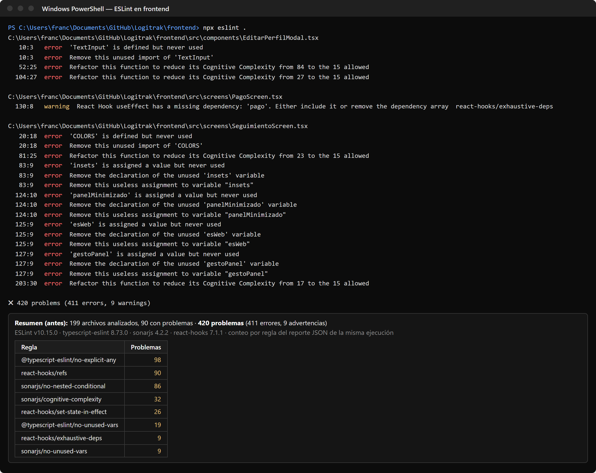
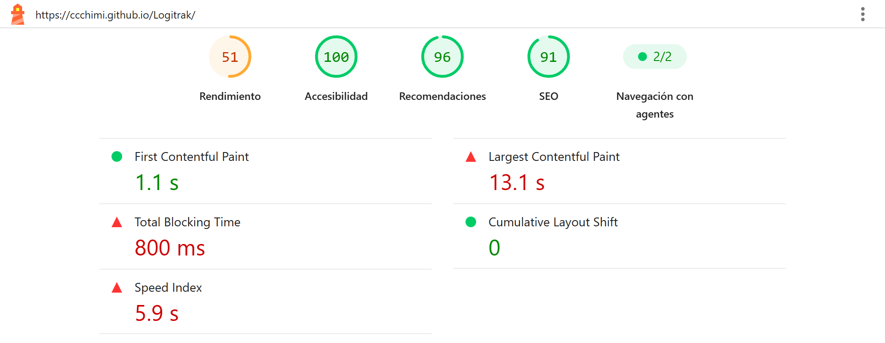
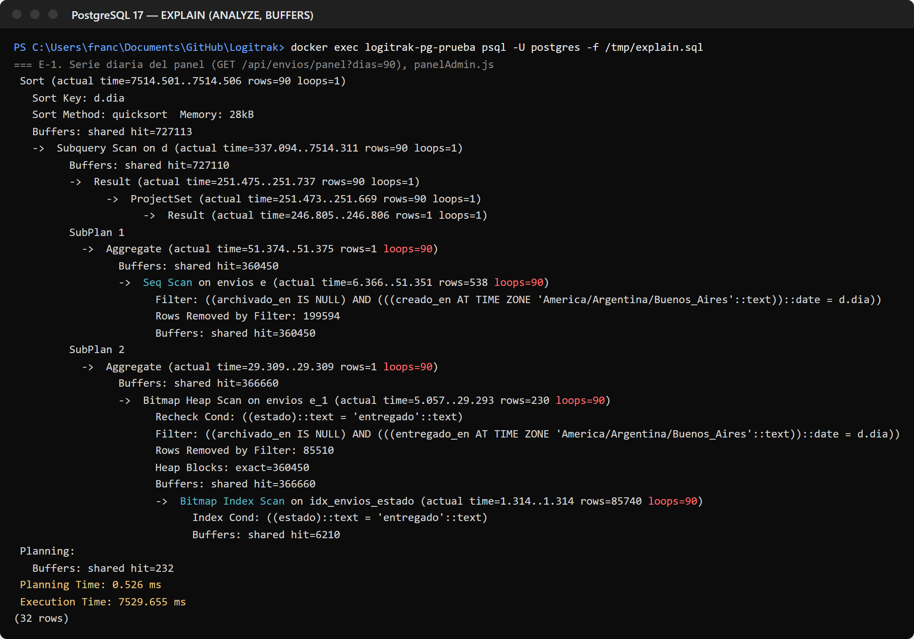
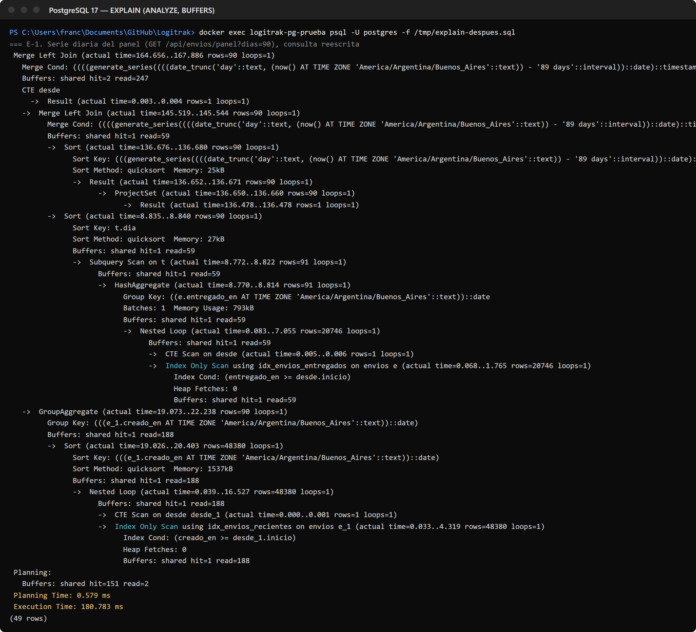

# Medición de la calidad de Logitrak (TP4)

> Sección de la memoria de tesis: **Ingeniería de Software › Verificación y Validación (QA)**
> Continúa las [pruebas unitarias](pruebas-unitarias.md) (TP1), el [plan de pruebas](plan-de-pruebas-cotizador.md) (TP2) y el [plan de mantenimiento](plan-de-mantenimiento.md) (TP3).
> Mediciones del 19/11/2026. Capturas en [`evidencias/tp4/`](evidencias/tp4/).

## 1. Objeto de estudio

Logitrak es un sistema mixto: una **Web App y una app móvil** (Expo / React Native, un único código para web, Android e iOS) que consume una **API REST propia** (Node.js + Express sobre PostgreSQL). Sus usuarios son **clientes** que envían paquetes o cargas, **choferes** que los toman y entregan, y el **equipo de Logitrak** (soporte y administradores).

## 2. Dimensiones de calidad

Los RNF son los del diseño del Parcial 1 del Seminario Final (RNF01 a RNF06). El plan del TP2 solo tenía requerimientos funcionales del cotizador.

| Dimensión | Por qué importa en Logitrak | RNF relacionado |
|---|---|---|
| Calidad del código (análisis estático), obligatoria | Cuatro personas mantienen unos 350 archivos entre app y API; la complejidad y el código muerto vuelven riesgoso cada cambio. | Sin RNF de mantenibilidad explícito; se vincula con RNF03 (regex con riesgo de ReDoS) y con el plan del TP3. |
| Rendimiento web, recursos y SEO | La Web App es la entrada de los clientes, casi siempre desde el celular. | RNF02 (menos de 3 s) y RNF04 (compatible con móviles y navegadores). |
| Seguridad de dependencias | Casi 1.400 paquetes de terceros entre app y API. | RNF03 (datos seguros) y RNF05 (autenticación y roles). |
| Rendimiento de base de datos | El panel del equipo calcula sobre todos los envíos; las pruebas corren con pocos datos. | RNF02 y RNF06 (múltiples usuarios simultáneos). |

## 3. Herramientas

| Herramienta | Qué mide | Cómo se ejecutó |
|---|---|---|
| **ESLint 10.15.0** + typescript-eslint 8.73.0, eslint-plugin-sonarjs 4.2.2 y eslint-plugin-react-hooks 7.1.1 | Errores probables, código muerto, complejidad cognitiva, regex peligrosas y uso de hooks, sin ejecutar el código. | Dependencia de desarrollo en `frontend/` y `backend/`, con `eslint.config` en cada uno: `npm run lint` (`npx eslint .`), y `-f json` para contar por regla. |
| **Lighthouse 13.6.0** (CLI) | Rendimiento, accesibilidad, buenas prácticas y SEO; FCP, LCP, TBT, CLS, Speed Index y peso. | `npx lighthouse@13.6.0 https://ccchimi.github.io/Logitrak/ --chrome-flags="--headless=new --incognito"`, Chrome 157, emulación mobile por defecto (Moto G Power, 4G lenta simulada). El reporte se pasó a español (es-419) con la traducción de Lighthouse, sin volver a medir. |
| **npm audit** (npm 12.0.2) | Dependencias con avisos de seguridad (GHSA), severidad y corrección disponible. | `npm audit` y `npm audit --omit=dev` en cada proyecto. |
| **EXPLAIN (ANALYZE, BUFFERS)**, PostgreSQL 17 | Plan real de cada consulta: índices o recorrido completo, repeticiones, bloques y tiempo. | Base local en Docker con todas las migraciones y **200.132 envíos** de prueba (nunca producción). |

ESLint, npm audit y PostgreSQL imprimen solo en inglés, así que sus capturas muestran la salida tal cual con un resumen en español debajo.

Configuración de ESLint ajustada a la tecnología antes de medir: `require()` permitido (imágenes de React Native), globales de Node en los archivos de configuración y `cotizador.generado.js` excluido de la API (lo genera esbuild desde el código de la app).

## 4 y 5. Resultados y hallazgos

Severidad: **Alta** si incumple un RNF o afecta directamente al usuario; **Media** si es un riesgo concreto de error, seguridad o mantenimiento; **Baja** si es prolijidad sin impacto inmediato.

### ESLint

App: **420 problemas** (411 errores, 9 avisos) en 90 de 199 archivos. API: **62 problemas** en 37 de 153 archivos.

| ID | Hallazgo | Dónde | Impacto | Sev. | Mejora | ¿Corregido? |
|---|---|---|---|---|---|---|
| H-01 | Complejidad cognitiva 84, 69 y 48 (máximo 15); 32 funciones en la app y 11 en la API superan el límite | `EditarPerfilModal.tsx:52`, `DetalleEnvioScreen.tsx:184`, `rutas/perfil.js:138` | Difícil de probar por completo; un cambio puede romper un camino no revisado | Media | Separar en funciones y componentes | No (planificado) |
| H-02 | Código muerto: 19 imports y variables sin usar y 9 valores que no se leen en la app; 3 asignaciones inútiles en la API | `SeguimientoScreen.tsx`, `ChoferScreen.tsx`, `rutas/auth.js:99-100`, `rutas/perfil.js:315` y otros | Confunde al leer y agranda el paquete | Baja | Borrarlo | Sí: app 420 → 375, API 62 → 58 |
| H-03 | 9 hooks con dependencias incompletas o sobrantes | `PagoScreen.tsx:130`, `SoporteScreen.tsx:210`, `MapaSeguimiento.tsx:84` | Efectos que trabajan con datos viejos | Media | Revisar cada dependencia | No |
| H-04 | 8 `catch` vacíos | `almacenamiento.ts`, `api.ts:92`, `pushService.ts:59` | Fallas del llavero o del push sin rastro en Sentry | Media | Registrar el error o documentar por qué se ignora | No |
| H-05 | 12 regex con backtracking superlineal (ReDoS) | `rutas/perfil.js:16`, `helpers/perfil.ts:4`, `api.ts:26`, `botLogistica/direcciones.ts:65 y 99` | Un texto armado puede trabar la API para todos | Media | Reescribirlas y limitar el largo de la entrada | No |
| H-06 | 98 usos de `any` | Navegación y respuestas de la API | TypeScript deja de detectar errores de tipos | Baja | Tipar navegación y respuestas | No |

### Lighthouse (mobile, incógnito)

Rendimiento **51**, Accesibilidad 100, Buenas prácticas 96, SEO **91**. FCP 1,1 s, **LCP 13,1 s**, TBT 800 ms, CLS 0, Speed Index 5,9 s, **peso 2.394 KiB**.

| ID | Hallazgo | Dónde | Impacto | Sev. | Mejora | ¿Corregido? |
|---|---|---|---|---|---|---|
| H-07 | LCP de 13,1 s en mobile | Portada (`screens/Inicio.tsx`) | Incumple RNF02; el cliente puede irse antes de cotizar | Alta | Aliviar imagen (H-08) y JavaScript (H-09) | Parcial: 10,0 s |
| H-08 | Portada JPG de 831 KB a 2000 × 1333 px; ahorro estimado 675 KiB | `assets/hero-warehouse.jpg` | Es el recurso que define el LCP | Alta | 1600 px en WebP | Sí: 243 KB |
| H-09 | Paquete JS único de 854 KiB, 500 KiB sin usar en la portada; TBT 800 ms | `expo/static/js/web/index-*.js` | Se descargan todas las pantallas para ver la portada | Media | Carga diferida de pantallas | No |
| H-10 | Sin meta description | HTML generado por Expo | Peor resultado en buscadores | Baja | Plantilla `public/index.html` | Sí: SEO 100 |
| H-11 | Caché corta (ahorro 2.192 KiB en visitas repetidas) | GitHub Pages, `max-age=600` | Se descarga todo de nuevo al volver | Baja | Hosting con caché larga para archivos con hash | No (depende del hosting) |

### npm audit

API: **2 moderadas** (385 dependencias). App: **25 moderadas** (997 dependencias), **6 en producción**. Son tres avisos repetidos por cada paquete que depende de ellos.

| ID | Hallazgo | Dónde | Impacto | Sev. | Mejora | ¿Corregido? |
|---|---|---|---|---|---|---|
| H-12 | minimatch 7.0.0 a 11.0.0, DoS por expansión de patrones (GHSA-g3hv-75wg-m249) | eslint-plugin-sonarjs (app y API), @expo/fingerprint | La herramienta de calidad de este TP llevó la API de 0 a 2 vulnerabilidades | Media | `overrides` a minimatch 11.0.9 | Sí: API 2 → 0 |
| H-13 | glob 9.0.0 a 14.0.1, la cancelación no detiene el recorrido (GHSA-3g3m-2fjr-6pw4) | @sentry/react-native (producción) y Jest | Llega al paquete de producción | Media | `overrides` a glob 14.0.6 | Sí: app 25 → 2, producción 6 → 0 |
| H-14 | uuid < 11.1.1 (GHSA-w5hq-g745-h8pq), sin corrección | @expo/ngrok (solo desarrollo) | No llega a producción | Baja | Quitar @expo/ngrok o esperar la actualización | No |

### EXPLAIN ANALYZE

La base tiene índices para todo lo que consulta un cliente o un chofer. Los problemas están en el **panel del equipo**, que recorre todos los envíos.

| ID | Hallazgo | Dónde | Impacto | Sev. | Mejora | ¿Corregido? |
|---|---|---|---|---|---|---|
| H-15 | Serie por día con dos subconsultas por día que recorren toda la tabla: 180 recorridos para 90 días, 7.529,7 ms, 727.113 bloques | `GET /api/envios/panel?dias=90`, `servicios/envios/panelAdmin.js` | Incumple RNF02 y ocupa una conexión 7 s por administrador (RNF06) | Alta | Un solo recorrido agrupado e índice por fecha | Sí: 180,8 ms |
| H-16 | Primera página de pedidos: recorre y ordena toda la tabla para 20 filas (33,4 ms) | `GET /api/envios/consulta` | Crece en forma lineal con la tabla | Media | Índice parcial `(creado_en DESC, id DESC)` | Sí: 0,021 ms |
| H-17 | Búsqueda con `ILIKE '%texto%'`: recorrido completo, 95,8 ms | `condicionesDePedidos`, `panelAdmin.js:158` | Búsqueda cada vez más lenta | Media | Índice GIN con pg_trgm | No (planificado) |

## 6. Mejoras y re-medición

Commit `b334098`. Antes de subirlo pasaron las 379 pruebas del backend, las 254 de la app, `tsc` y el export web; la CI quedó en verde.

| Hallazgos | Cambio | Antes | Después |
|---|---|---|---|
| H-15, H-16 | Serie del panel en un solo recorrido agrupado (mismos números, 0 diferencias en 90 días) y migración `1795030000000_indices-panel-del-equipo.js` | E-1 7.529,7 ms (Seq Scan × 90); E-2 33,4 ms | E-1 180,8 ms (−97,6 %, Index Only Scan); E-2 0,021 ms |
| H-08, H-10 | Portada en WebP de 1600 px y `frontend/public/index.html` con meta description y `lang="es"` | Rendimiento 51, SEO 91, LCP 13,1 s, 2.394 KiB | Rendimiento 62, SEO 100, LCP 10,0 s, 1.806 KiB |
| H-12, H-13 | `overrides`: minimatch 11.0.9 y glob 14.0.6 | API 2; app 25 (6 en producción) | API 0; app 2 (0 en producción) |
| H-02 | Código sin uso eliminado | App 420; API 62 | App 375; API 58 |

El LCP sigue lejos de los 3 s del RNF02: ahora lo frena el paquete de JavaScript (H-09). Lighthouse varía entre corridas, sobre todo en TBT y Speed Index; los cambios de peso, SEO e imágenes no dependen de esa variación. Los 2 `no-unused-vars` que quedan en la API son falsos positivos: el manejador de errores de Express necesita cuatro parámetros.

## 7. Cierre

Lo más revelador fue la serie del panel: sus pruebas pasaban y respondía al instante con datos de prueba, pero con 200.000 envíos tardaba 7,5 s. Solo apareció midiendo con volumen. También sorprendió que el propio plugin de SonarJS trajera una vulnerabilidad a una API que tenía cero.

Hasta la presentación final:

- **npm audit:** ya corre en cada push en la CI (producción, informativo); reporte completo una vez por semana y Dependabot para avisar actualizaciones.
- **ESLint:** `npm run lint` antes de subir; sumarlo a la CI con un máximo de problemas que solo pueda bajar.
- **Lighthouse:** antes de cada entrega y cuando cambien la portada, las imágenes o las dependencias, en mobile e incógnito.
- **EXPLAIN ANALYZE:** al agregar o cambiar consultas del panel o de listados, sobre la base local con volumen.
- **Ronda completa:** una vez por semana, comparando con estos valores.
