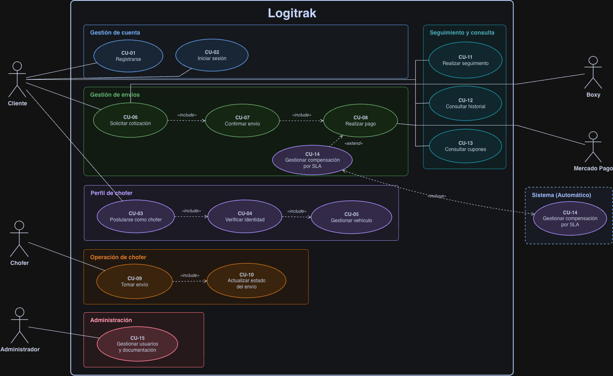

# 3. Diagrama de casos de uso

Diagrama del Parcial 1, con los 15 casos de uso agrupados por área y los actores que participan en cada uno.

## Actores

| Actor | Tipo | Participa en |
|---|---|---|
| Cliente | Principal | CU-01, CU-02, CU-03, CU-06, CU-07, CU-08, CU-11, CU-12, CU-13 |
| Chofer | Principal | CU-02, CU-04, CU-05, CU-09, CU-10 |
| Administrador | Principal | CU-02, CU-04 (secundario), CU-15 |
| Boxy | Secundario (asistente de la app) | CU-06 |
| Mercado Pago | Sistema externo | CU-08 |
| Sistema (automático) | Principal en procesos sin usuario | CU-14 |

## Relaciones

| Relación | Tipo | Significado |
|---|---|---|
| CU-06 → CU-07 → CU-08 | «include» | Solicitar la cotización lleva a confirmar el envío, y confirmarlo lleva al pago |
| CU-14 → CU-08 | «extend» | La compensación por SLA extiende el circuito del envío pago cuando se incumple el plazo |
| CU-03 → CU-04 → CU-05 | «include» | La postulación como chofer incluye verificar la identidad y declarar el vehículo |
| CU-09 → CU-10 | «include» | Tomar un envío lleva a actualizar sus estados durante el viaje |

## Cambios desde el diseño

El diagrama sigue representando el sistema. La implementación sumó, sin cambiar los casos de uso existentes:

- **Rol soporte**, que comparte con el administrador la atención de consultas y la supervisión, sin acceso a dinero, roles ni documentos de identidad.
- **Casos de apoyo** que no estaban en el diseño: cancelar un envío, chatear con el chofer, calificar el envío, atender consultas de soporte y recuperar la contraseña a través de soporte. Su detalle está en [casos de uso](04-casos-de-uso.md#casos-de-uso-agregados-en-la-implementación).
