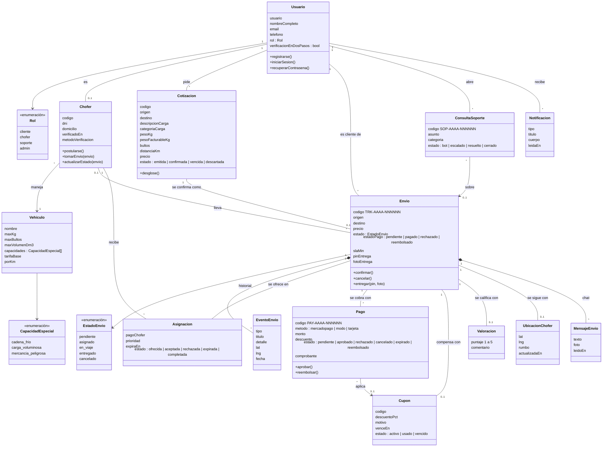
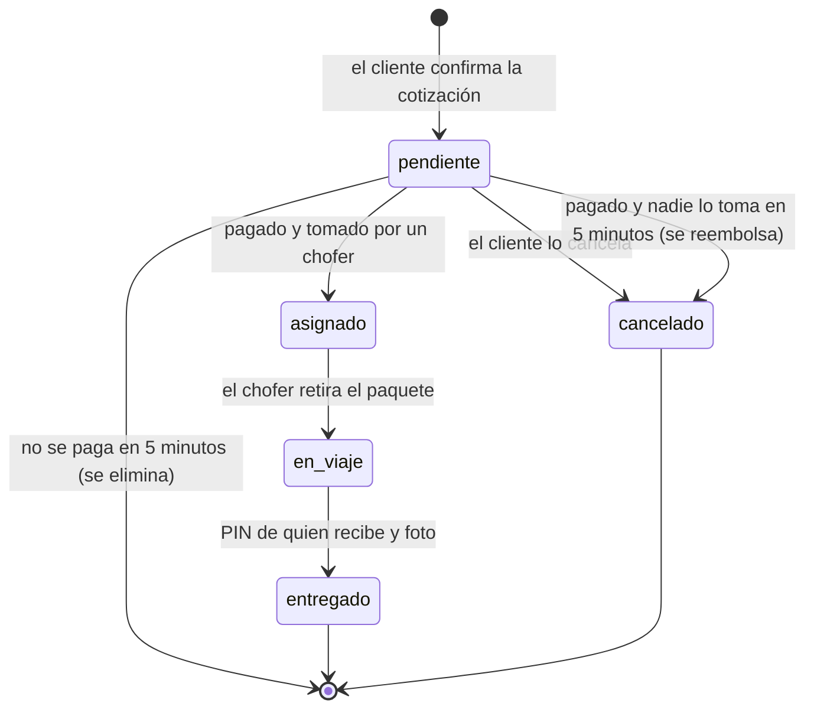

# 7. Diagrama de clases de dominio

Modelo conceptual de Logitrak: los objetos del negocio, sus atributos principales, sus estados y cómo se relacionan. No describe cómo está programado (eso es el [diagrama de clases de diseño](12-diagrama-de-clases-de-diseno.md)) ni cómo se guarda (eso es el [diagrama de entidad relación](08-diagrama-entidad-relacion.md)), aunque cada clase corresponde a una tabla de la base.

## 7.1 Diagrama

## 7.2 Clases y reglas del negocio

| Clase | Qué representa | Reglas principales |
|---|---|---|
| **Usuario** | Cualquier persona con cuenta | Se registra siempre como cliente; el rol lo cambia un administrador o la postulación como chofer |
| **Chofer** | Un usuario habilitado para llevar envíos | Necesita la identidad verificada y un vehículo de la flota; lleva un envío a la vez |
| **Vehiculo** | Una unidad de la flota | Su capacidad decide qué envíos puede llevar, con las mismas reglas que la cotización |
| **Cotizacion** | El precio que calcula Boxy para una carga | Vale por un tiempo; el servidor la recalcula antes de cobrarla |
| **Envio** | El servicio contratado | Se paga dentro de 5 minutos; se ofrece a choferes compatibles; se entrega con el PIN de quien recibe y una foto |
| **EventoEnvio** | Un hito del recorrido | Forma la línea de tiempo que ve el cliente; no se borra |
| **Asignacion** | La oferta de un envío a un chofer | La gana el primero que acepta; vence a los 5 minutos |
| **Pago** | Un intento de cobro | Un reintento no cobra dos veces; un cobro duplicado se devuelve |
| **Cupon** | Una compensación para el cliente | Se genera al incumplir el plazo de retiro (10 %); vence a los 90 días |
| **Valoracion** | La calificación del chofer | Una sola por envío entregado |
| **UbicacionChofer** | La última posición del chofer en un viaje | Solo existe mientras dura el viaje |
| **MensajeEnvio** | Un mensaje del chat del envío | Solo entre el cliente y el chofer, mientras dura el viaje |
| **ConsultaSoporte** | Un pedido de ayuda | La atiende el asistente y, si hace falta, una persona del equipo |
| **Notificacion** | Un aviso para el usuario | Se genera a partir de los eventos del sistema |

## 7.3 Ciclo de vida de un envío

