# 8. Diagrama de entidad relación

Modelo de datos de Logitrak tal como está en PostgreSQL. Los diagramas están **generados desde el esquema real de la base** (con todas las migraciones aplicadas al 27/11/2026): 21 tablas, 282 columnas y 35 claves foráneas. Por eso incluyen todas las columnas con su tipo, y no una versión simplificada.

Se divide en dos diagramas para que se puedan leer: la operación del negocio, y el soporte, los avisos y la seguridad. Las tablas que aparecen sin columnas en el segundo diagrama están detalladas en el primero.

**Notación:** `PK` clave primaria, `FK` clave foránea, `UK` valor único. `||--o{` uno a muchos obligatorio; `|o--o{` uno a muchos opcional (la clave foránea admite nulos); `--o|` uno a uno.

## 8.1 Operación del negocio

Usuarios, choferes y su vehículo; la cotización y el envío con sus eventos, ofertas, pagos, cupones, calificación, ubicación del chofer y chat.

```mermaid
erDiagram
    choferes ||--o{ asignaciones : "chofer_id"
    envios |o--o{ asignaciones : "envio_id"
    usuarios ||--o| choferes : "usuario_id"
    vehiculos |o--o{ choferes : "vehiculo_id"
    usuarios |o--o{ cotizaciones : "cliente_id"
    vehiculos |o--o{ cotizaciones : "vehiculo_id"
    usuarios ||--o{ cupones : "cliente_id"
    envios |o--o{ cupones : "envio_id"
    envios |o--o{ cupones : "usado_envio_id"
    envios ||--o{ envio_eventos : "envio_id"
    usuarios |o--o{ envio_mensajes : "autor_id"
    envios ||--o{ envio_mensajes : "envio_id"
    usuarios |o--o{ envios : "archivado_por"
    choferes |o--o{ envios : "chofer_id"
    usuarios ||--o{ envios : "cliente_id"
    cotizaciones |o--o{ envios : "cotizacion_id"
    vehiculos |o--o{ envios : "vehiculo_id"
    usuarios ||--o{ pagos : "cliente_id"
    cupones |o--o{ pagos : "cupon_id"
    envios ||--o{ pagos : "envio_id"
    choferes ||--o{ ubicaciones_chofer : "chofer_id"
    envios ||--o| ubicaciones_chofer : "envio_id"
    choferes ||--o{ valoraciones : "chofer_id"
    usuarios |o--o{ valoraciones : "cliente_id"
    envios ||--o| valoraciones : "envio_id"
    usuarios {
        int id PK
        varchar usuario UK
        text contrasena_hash
        varchar rol
        varchar nombre_completo
        timestamptz creado_en
        timestamptz eliminado_en
        varchar email
        varchar telefono
        text totp_secreto
        text totp_pendiente
        timestamptz totp_pendiente_en
        timestamptz totp_activado_en
        bigint totp_ultimo_paso
        timestamptz contrasena_temporal_vence_en
    }
    choferes {
        int id PK
        varchar codigo UK
        int usuario_id FK, UK
        varchar nombre_completo
        varchar email
        varchar telefono
        varchar domicilio
        varchar dni UK
        bool escaneo_facial_ok
        varchar verificacion_renaper
        varchar renaper_modo
        varchar metodo_verificacion
        varchar selfie_path
        varchar dni_frente_path
        timestamptz verificado_en
        timestamptz creado_en
        bool liveness_ok
        decimal face_match_score
        varchar vehiculo_id FK
    }
    vehiculos {
        varchar id PK
        varchar nombre
        decimal max_kg
        int max_bultos
        decimal max_volumen_dm3
        decimal tarifa_base
        decimal por_kg
        decimal por_bulto
        decimal por_km
        decimal velocidad_media_kmh
        array capacidades
    }
    cotizaciones {
        int id PK
        varchar codigo UK
        int cliente_id FK
        varchar origen
        varchar destino
        varchar descripcion_carga
        varchar categoria_carga
        decimal peso_kg
        decimal peso_facturable_kg
        int bultos
        decimal largo_cm
        decimal ancho_cm
        decimal alto_cm
        decimal valor_declarado
        varchar vehiculo_id FK
        varchar vehiculo_nombre
        decimal distancia_km
        bool distancia_estimada
        decimal precio
        varchar moneda
        varchar confianza
        int puntaje_confianza
        int validez_min
        varchar estado
        jsonb detalle
        timestamptz emitida_en
    }
    envios {
        int id PK
        varchar codigo UK
        int cliente_id FK
        int cotizacion_id FK
        int chofer_id FK
        varchar origen
        varchar destino
        decimal origen_lat
        decimal origen_lng
        decimal destino_lat
        decimal destino_lng
        varchar descripcion_carga
        varchar categoria_carga
        decimal peso_kg
        int bultos
        varchar vehiculo_id FK
        varchar vehiculo_nombre
        decimal distancia_km
        decimal precio
        varchar moneda
        varchar estado
        int sla_min
        timestamptz sla_vence_en
        varchar chofer_nombre
        timestamptz creado_en
        timestamptz actualizado_en
        timestamptz entregado_en
        varchar estado_pago
        timestamptz oferta_vence_en
        timestamptz archivado_en
        int archivado_por FK
        varchar archivado_motivo
        timestamptz sla_revisado_en
        timestamptz pago_vence_en
        char pin_entrega
        smallint pin_intentos
        timestamptz pin_bloqueado_en
        varchar foto_entrega_path
        timestamptz retirado_en
        decimal peso_facturable_kg
        decimal volumen_dm3
        varchar capacidad_requerida
    }
    asignaciones {
        int id PK
        varchar codigo UK
        int chofer_id FK
        int envio_id FK
        varchar origen
        varchar destino
        decimal distancia_km
        varchar descripcion_carga
        varchar categoria_etiqueta
        decimal peso_kg
        int bultos
        varchar vehiculo_requerido
        decimal tarifa
        decimal pago_chofer
        varchar prioridad
        int eta_retiro_min
        int tiempo_viaje_min
        varchar estado
        jsonb recomendacion
        array requisitos
        timestamptz generada_en
        timestamptz expira_en
        timestamptz respondida_en
    }
    envio_eventos {
        int id PK
        int envio_id FK
        varchar tipo
        varchar titulo
        varchar detalle
        decimal lat
        decimal lng
        timestamptz creado_en
    }
    pagos {
        int id PK
        varchar codigo UK
        int envio_id FK
        int cliente_id FK
        varchar metodo
        decimal monto
        varchar moneda
        varchar estado
        varchar modo_proc
        varchar tarjeta_marca
        varchar tarjeta_ultimos
        int cuotas
        varchar referencia_ext
        varchar pago_ext_id
        varchar comprobante
        jsonb detalle
        timestamptz creado_en
        timestamptz actualizado_en
        timestamptz pagado_en
        timestamptz reembolsado_en
        uuid idempotency_key
        jsonb checkout_datos
        int cupon_id FK
        decimal descuento
    }
    cupones {
        int id PK
        varchar codigo UK
        int cliente_id FK
        int envio_id FK
        int descuento_pct
        varchar motivo
        varchar estado
        timestamptz creado_en
        timestamptz usado_en
        int usado_envio_id FK
        timestamptz vence_en
        timestamptz aviso_vencimiento_en
    }
    valoraciones {
        int id PK
        int envio_id FK, UK
        int chofer_id FK
        int cliente_id FK
        smallint puntaje
        text comentario
        timestamptz creado_en
    }
    ubicaciones_chofer {
        int envio_id PK, FK
        int chofer_id FK
        decimal lat
        decimal lng
        int precision_m
        smallint rumbo
        smallint velocidad_kmh
        timestamptz actualizado_en
    }
    envio_mensajes {
        bigint id PK
        int envio_id FK
        int autor_id FK
        varchar autor_rol
        varchar texto
        timestamptz creado_en
        timestamptz leido_en
        varchar foto_ruta
        varchar foto_tipo
    }
```

## 8.2 Soporte, avisos y seguridad

```mermaid
erDiagram
    usuarios ||--o{ codigos_respaldo : "usuario_id"
    outbox_events |o--o| notificaciones : "evento_id"
    usuarios ||--o| notificaciones : "usuario_id"
    usuarios ||--o{ push_tokens : "usuario_id"
    usuarios ||--o{ sesiones : "usuario_id"
    usuarios |o--o{ soporte_mensajes : "autor_id"
    soporte_tickets ||--o{ soporte_mensajes : "ticket_id"
    usuarios |o--o{ soporte_tickets : "admin_id"
    envios |o--o{ soporte_tickets : "envio_id"
    usuarios ||--o{ soporte_tickets : "usuario_id"
    soporte_tickets {
        int id PK
        varchar codigo UK
        int usuario_id FK
        int envio_id FK
        varchar asunto
        varchar categoria
        varchar estado
        int admin_id FK
        timestamptz ultimo_mensaje_en
        timestamptz creado_en
        timestamptz actualizado_en
        timestamptz resuelto_en
    }
    soporte_mensajes {
        int id PK
        int ticket_id FK
        varchar autor
        int autor_id FK
        varchar autor_nombre
        text texto
        varchar adjunto_ruta
        varchar adjunto_nombre
        varchar adjunto_tipo
        int adjunto_bytes
        timestamptz creado_en
    }
    notificaciones {
        bigint id PK
        int usuario_id FK, UK
        bigint evento_id FK, UK
        varchar tipo
        varchar titulo
        varchar cuerpo
        jsonb datos
        timestamptz creada_en
        timestamptz leida_en
    }
    outbox_events {
        bigint id PK
        varchar aggregate_type
        varchar aggregate_id
        varchar event_type
        jsonb payload
        bool processed
        timestamptz processed_at
        int attempts
        timestamptz next_attempt_at
        text last_error
        timestamptz failed_at
        timestamptz created_at
    }
    push_tokens {
        int id PK
        int usuario_id FK
        varchar token UK
        varchar plataforma
        timestamptz creado_en
        timestamptz actualizado_en
    }
    sesiones {
        int id PK
        int usuario_id FK
        uuid familia
        char token_hash UK
        timestamptz creado_en
        timestamptz expira_en
        timestamptz revocado_en
        varchar motivo_revocacion
        varchar ip
        varchar user_agent
    }
    codigos_respaldo {
        int id PK
        int usuario_id FK
        char hash
        timestamptz creado_en
        timestamptz usado_en
    }
    auditoria_accesos {
        int id PK
        varchar usuario
        bool exito
        varchar motivo
        varchar ip
        varchar user_agent
        timestamptz fecha
    }
    archivos_por_borrar {
        varchar ruta PK
        varchar motivo
        smallint intentos
        varchar ultimo_error
        timestamptz ultimo_intento_en
        timestamptz creado_en
    }
```

## 8.3 Diccionario de tablas

| Tabla | Qué guarda | Relaciones principales |
|---|---|---|
| `usuarios` | Cuentas de todos los roles (cliente, chofer, soporte, admin), con la contraseña como hash bcrypt, la verificación en dos pasos y la contraseña temporal | Es la raíz de casi todo |
| `choferes` | Ficha del chofer: datos personales, DNI, vehículo y resultado de la verificación de identidad | 1 a 1 con `usuarios`; muchos a 1 con `vehiculos` |
| `vehiculos` | Flota: capacidad de peso, bultos y volumen, tarifas y capacidades especiales (cadena de frío, carga voluminosa, mercancía peligrosa) | La usan choferes, cotizaciones y envíos |
| `cotizaciones` | Cada cotización de Boxy con la carga, el vehículo elegido, la distancia, el precio y su detalle | Un envío nace de una cotización |
| `envios` | El envío: origen y destino, carga, precio, estado y estado del pago, plazos (pago, oferta, SLA), PIN y foto de entrega, archivo | Tabla central: la referencian eventos, pagos, cupones, ofertas, chat, ubicación y valoración |
| `asignaciones` | Las ofertas a choferes y la que se aceptó, con el pago al chofer y su estado | Muchas por envío; muchas por chofer |
| `envio_eventos` | Línea de tiempo del envío: creado, asignado, en camino, retirado, entregado, SLA excedido, cancelado | Muchos por envío |
| `pagos` | Cada intento de pago con su método, estado, comprobante, clave de idempotencia y datos de la pasarela | Muchos por envío; opcionalmente con un cupón |
| `cupones` | Cupones de compensación con su porcentaje, vencimiento y uso | Del cliente; generado por un envío y usado en otro |
| `valoraciones` | Calificación del chofer (1 a 5) y comentario | 1 a 1 con el envío |
| `ubicaciones_chofer` | Solo la última posición del chofer durante el viaje; se borra al terminar | 1 a 1 con el envío |
| `envio_mensajes` | Chat del envío entre cliente y chofer, con fotos | Muchos por envío |
| `soporte_tickets`, `soporte_mensajes` | Consultas de soporte y sus mensajes (cliente, asistente o equipo) | Del usuario; opcionalmente asociadas a un envío |
| `notificaciones` | Bandeja de avisos de cada usuario | Generadas por un evento del outbox |
| `outbox_events` | Eventos pendientes de despachar (patrón outbox), con reintentos | Generan notificaciones y push |
| `push_tokens` | Teléfonos registrados para push (hasta 5 por usuario) | Del usuario |
| `sesiones` | Refresh tokens guardados como hash, con su familia para detectar reuso | Del usuario |
| `codigos_respaldo` | Códigos de respaldo de la verificación en dos pasos, como hash | Del usuario |
| `auditoria_accesos` | Intentos de ingreso con su resultado; la IP se anonimiza al año | Por nombre de usuario, sin clave foránea, para conservar los intentos fallidos |
| `archivos_por_borrar` | Archivos de Storage que quedaron pendientes de borrar | Independiente: la procesa el trabajo `borrar-archivos` |

## 8.4 Reglas de integridad

| Regla | Cómo la garantiza la base |
|---|---|
| Un chofer lleva un solo envío a la vez | Índice único parcial `uq_envios_un_viaje_por_chofer` sobre `envios(chofer_id)` para los estados `asignado` y `en_viaje` |
| Estados válidos | Restricciones `CHECK`: envío (`pendiente`, `asignado`, `en_viaje`, `entregado`, `cancelado`), pago del envío (`pendiente`, `pagado`, `rechazado`, `reembolsado`), pago (`pendiente`, `aprobado`, `rechazado`, `cancelado`, `expirado`, `reembolsado`), oferta (`ofrecida`, `aceptada`, `rechazada`, `expirada`, `completada`), cupón (`activo`, `usado`, `vencido`), consulta (`bot`, `escalado`, `resuelto`, `cerrado`), rol (`cliente`, `chofer`, `soporte`, `admin`) |
| Un envío se califica una sola vez | `valoraciones.envio_id` único |
| Un pago no se duplica por reintento | Clave de idempotencia única por cliente en `pagos` |
| Códigos legibles y únicos | `envios.codigo` (`TRK-AAAA-NNNNNN`), `pagos.codigo` (`PAY-AAAA-NNNNNN`), `soporte_tickets.codigo` (`SOP-AAAA-NNNNNN`), generados por secuencias |
| Cada usuario lee solo lo suyo por Realtime | Seguridad a nivel de fila (RLS) activa en todas las tablas |
| El esquema evoluciona sin perder datos | Migraciones versionadas con node-pg-migrate en `backend/migrations/`, aplicadas al arrancar la API |

Los trabajos de pg-boss usan su propio esquema (`pgboss`), que crea y administra la librería; no forma parte del modelo de Logitrak.
