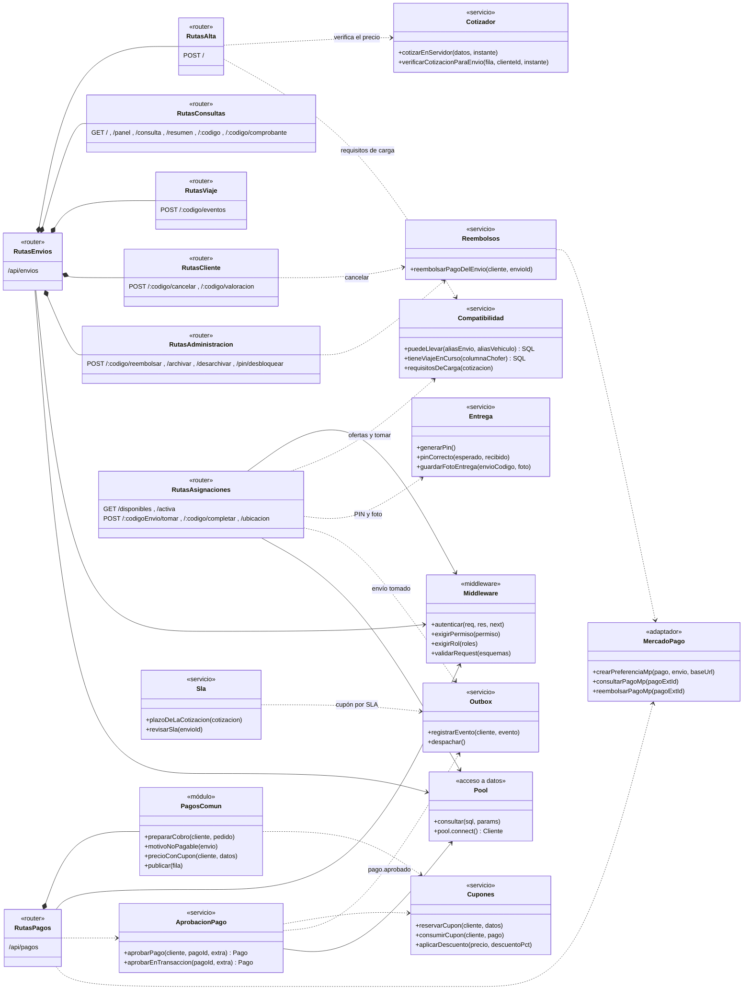
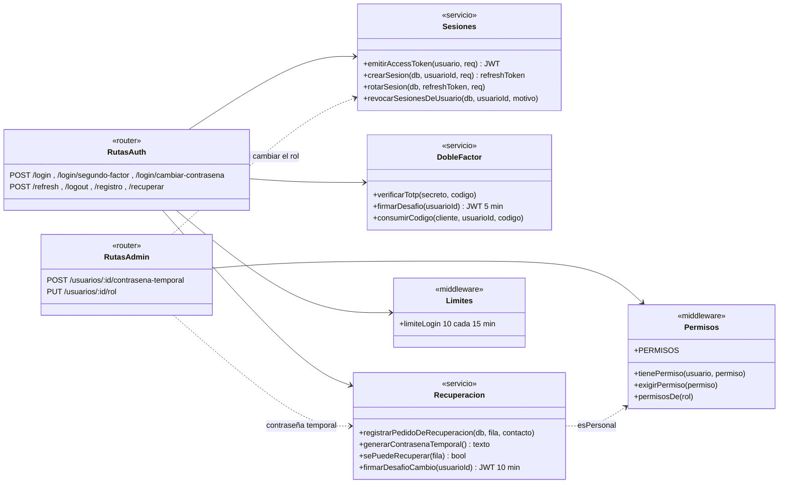
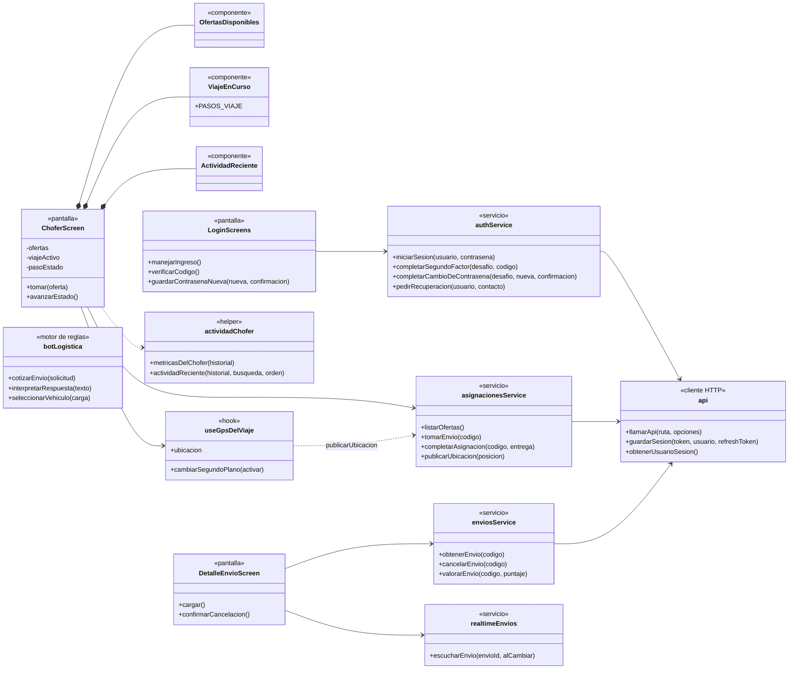

# 12. Diagrama de clases de diseño

El diagrama de clases de dominio (entregable 7, en el Parcial 1) muestra los conceptos del negocio: cliente, envío, pago, chofer. Este documento muestra **cómo está construido el software**: los módulos reales del código, qué ofrecen y de qué dependen.

Logitrak está escrito en JavaScript y TypeScript con funciones y módulos, no con clases. Por eso cada "clase" del diagrama es un **módulo** (un archivo), con el estereotipo que indica su papel, y sus operaciones son las funciones que exporta, con los mismos nombres que en el código. Las relaciones son:

- `*--` composición: un módulo arma su comportamiento con otros (por ejemplo, el router de envíos con sus partes).
- `-->` asociación: un módulo usa a otro.
- `..>` dependencia: lo usa en una operación puntual.

Los diagramas están en Mermaid: GitHub los muestra como imagen.

## 12.1 Backend: envíos, asignación y pagos

**Decisiones de diseño que muestra el diagrama:**

- Los routers solo traducen HTTP: validan con `validarRequest` (Zod), comprueban el permiso y delegan. Las reglas de negocio están en los servicios, para que se puedan probar sin HTTP.
- La aprobación de un pago vive en un solo servicio (`AprobacionPago`), que usan el pago con tarjeta, la confirmación de prueba, la consulta del estado y los dos webhooks.
- `Compatibilidad` genera fragmentos SQL: la misma regla filtra las ofertas, valida al tomar un envío y elige a quién avisar, así nunca divergen.
- Ningún servicio manda avisos en el momento: registran un evento en el `Outbox` dentro de la misma transacción, y un trabajo en segundo plano los despacha.
- El acceso a la base es SQL parametrizado con `pg`, sin ORM, para poder usar bloqueos de fila (`FOR UPDATE`) donde hay concurrencia.

## 12.2 Backend: autenticación, sesiones y recuperación

## 12.3 App: pantallas, componentes y servicios

**Decisiones de diseño que muestra el diagrama:**

- Las pantallas solo coordinan el estado. Cada parte visible es un componente propio, y los cálculos y textos son funciones puras en `helpers/` con pruebas unitarias (observación del Parcial 2 sobre la modularización).
- Todas las llamadas a la API pasan por un único cliente HTTP (`api.ts`), que agrega el token, lo renueva solo cuando vence y guarda la sesión en el llavero del teléfono.
- `botLogistica` es el mismo código en la app (para responder al instante) y en el servidor (empaquetado con esbuild, para decidir el precio que se cobra).
