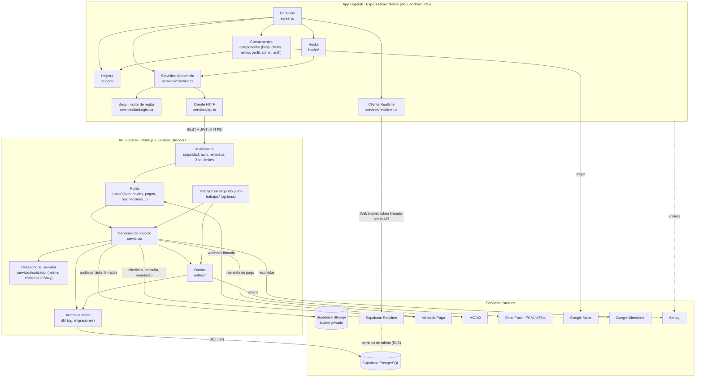

# 13. Diseño de componentes

Muestra cómo se divide Logitrak en componentes desplegables y módulos, qué responsabilidad tiene cada uno y por qué interfaces se comunican. Complementa el [diseño de la arquitectura](../informe-tecnico-parcial-2.md#4-diagrama-actualizado-de-arquitectura) (entregable 11), que muestra la vista general, y el [diagrama de clases de diseño](12-diagrama-de-clases-de-diseno.md), que baja al nivel de cada módulo.

## 13.1 Diagrama de componentes

## 13.2 Componentes y responsabilidades

### App (`frontend/src`)

| Componente | Responsabilidad | Ofrece | Usa |
|---|---|---|---|
| **Pantallas** (`screens/`, 22) | Coordinar el estado de cada pantalla y la navegación por rol | Navegación (`navigation/AppNavigator.tsx`) | Componentes, hooks, helpers, servicios |
| **Componentes** (`components/`) | Partes visibles reutilizables, agrupadas por dominio: `boxy/`, `chofer/`, `envio/`, `perfil/`, `admin/`, `auth/` | Props tipadas | Helpers, tema |
| **Hooks** (`hooks/`) | Comportamiento con estado: GPS del viaje, preferencias, tema, panel del equipo | Hooks de React | Servicios |
| **Helpers** (`helpers/`) | Cálculos y textos sin efectos: ganancias del chofer, textos del detalle, permisos por usuario, validaciones del perfil | Funciones puras con pruebas | — |
| **Boxy** (`services/botLogistica`) | Entender el pedido (direcciones, pesos, tipo de carga) y cotizar con reglas | `cotizarEnvio`, `interpretarRespuesta`, `seleccionarVehiculo` | — (corre en el dispositivo) |
| **Servicios de dominio** (`services/*Service.ts`) | Un servicio por recurso de la API: envíos, pagos, asignaciones, perfil, soporte, notificaciones | Funciones `async` con resultado `{ exito, … }` | Cliente HTTP |
| **Cliente HTTP** (`services/api.ts`) | Único punto de salida a la API: token, renovación automática, sesión en el llavero del teléfono | `llamarApi`, `guardarSesion` | API REST |
| **Cliente Realtime** (`services/realtime*.ts`, `chatEnvioService.ts`) | Escuchar cambios del envío, la ubicación del chofer y los chats | `escucharEnvio`, `escucharChat` | Supabase Realtime |

### API (`backend/src`)

| Componente | Responsabilidad | Ofrece | Usa |
|---|---|---|---|
| **Middleware** (`middleware/`) | Encabezados de seguridad, CORS, límites de pedidos, autenticación, permisos por capacidad y validación con Zod | `autenticar`, `exigirPermiso`, `validarRequest` | Sesiones |
| **Rutas** (`rutas/`) | Traducir HTTP: validar, comprobar permisos y delegar. Las grandes están divididas por responsabilidad (`rutas/envios/`, `rutas/pagos/`) | La API REST (`/api/*`) | Servicios |
| **Servicios de negocio** (`servicios/`) | Reglas: compatibilidad de vehículos, SLA, entrega con PIN, aprobación de pagos, cupones, reembolsos, sesiones, recuperación, retención de datos | Funciones probadas por separado | Acceso a datos, servicios externos |
| **Cotizador del servidor** (`servicios/cotizador`) | Recalcular el precio con el mismo código de Boxy, empaquetado con esbuild | `cotizarEnServidor`, `verificarCotizacionParaEnvio` | — |
| **Outbox** (`outbox/`) | Guardar cada aviso en la misma transacción que el cambio y despacharlo después | `registrarEvento`, `despachar` | Push, notificaciones |
| **Trabajos** (`trabajos/`) | Tareas periódicas con pg-boss: vencer ofertas e impagos, revisar el SLA, cupones, cobros de más, borrar archivos, plazos de conservación | Colas `COLAS` | Servicios, Outbox |
| **Acceso a datos** (`db/`) | Conexión con límites de tiempo, migraciones versionadas al arrancar | `consultar`, `pool` | PostgreSQL |

## 13.3 Principios del diseño

- **Dependencias en una sola dirección.** Pantallas → servicios → cliente HTTP en la app; rutas → servicios → acceso a datos en la API. Ninguna capa de abajo conoce a la de arriba.
- **Un único punto de contacto con cada sistema externo.** La app solo habla con la API (más el mapa y Realtime, de solo lectura); la API es la única que escribe en la base y la única que habla con las pasarelas, Storage y el servicio de push.
- **La misma regla, un solo lugar.** El precio (Boxy) y la compatibilidad de vehículos (`compatibilidad.js`) se escriben una vez y se reutilizan donde hacen falta.
- **Efectos externos fuera de la transacción.** Los avisos pasan por el Outbox y los archivos que no se pudieron borrar quedan anotados para reintentar.
