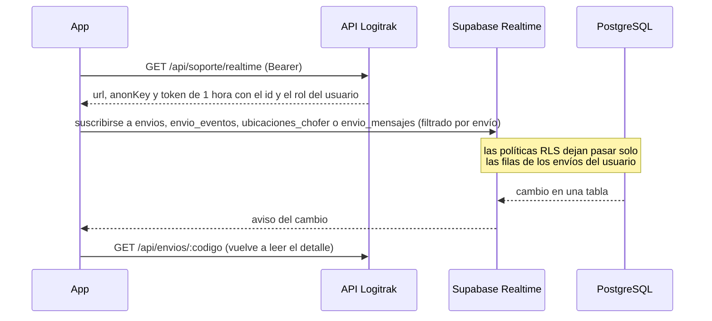
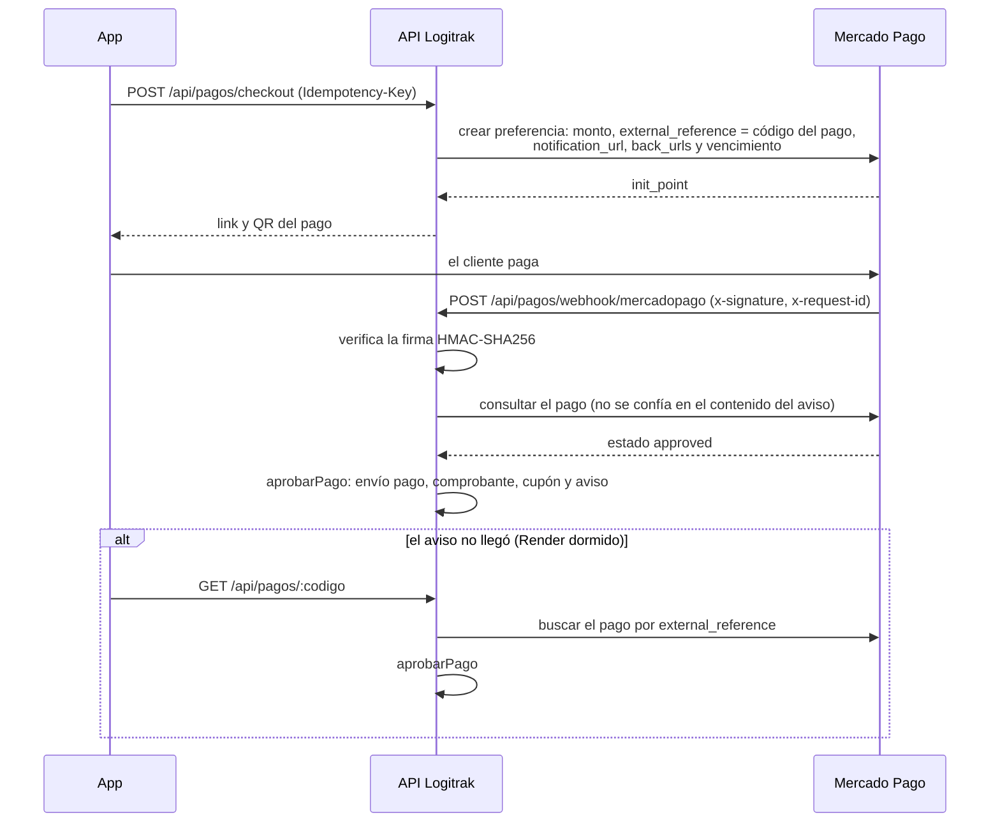

# 14. Diseño de las interfaces entre sistemas

Describe cada interfaz entre Logitrak y otro sistema: quién llama a quién, con qué protocolo, cómo se autentica, qué datos viajan y qué pasa si el otro lado falla. Qué integraciones son reales y cuáles están simuladas está en [integraciones](../integraciones.md); la lista completa de rutas de la API, en el [README del backend](../../backend/README.md).

## 14.1 Mapa de interfaces

| # | Desde | Hacia | Protocolo | Autenticación | Para qué |
|---|---|---|---|---|---|
| I-01 | App | API Logitrak | HTTPS, REST + JSON | JWT de acceso (15 min) + refresh token rotativo | Todo lo que la app hace con datos |
| I-02 | API | PostgreSQL (Supabase) | Protocolo de PostgreSQL con SSL (`pg`) | Usuario y contraseña en `DATABASE_URL` | Guardar y consultar los datos |
| I-03 | API | Supabase Storage | HTTPS (SDK de Supabase) | Clave de servicio, solo en el servidor | DNI, selfies, fotos de entrega y del chat, adjuntos |
| I-04 | App | Supabase Realtime | WebSocket | Token de 1 hora firmado por la API | Seguimiento, ubicación del chofer y chats en vivo |
| I-05 | API | Mercado Pago | HTTPS (SDK oficial) | `MP_ACCESS_TOKEN` | Checkout, QR, consulta y reembolso de pagos |
| I-06 | Mercado Pago | API | Webhook HTTPS | Firma HMAC-SHA256 (`x-signature`) | Avisar que un pago cambió |
| I-07 | API | MODO | HTTPS (REST) | OAuth: token con `MODO_CLIENT_ID` y `MODO_CLIENT_SECRET` | Pagar con billeteras bancarias |
| I-08 | API | Expo Push (FCM / APNs) | HTTPS (`expo-server-sdk`) | `EXPO_ACCESS_TOKEN` opcional | Notificaciones en el teléfono |
| I-09 | API | Google Directions | HTTPS (REST) | `GOOGLE_DIRECTIONS_KEY`, solo en el servidor | Distancia por calle para la cotización y recorrido para el mapa del teléfono |
| I-10 | App | Google Maps | SDK de mapas | Claves públicas restringidas por app y dominio | Dibujar el mapa |
| I-11 | App y API | Sentry | HTTPS (SDK) | DSN | Reportar errores |
| I-12 | API | RENAPER | — | — | Validación oficial de identidad. **No implementada** (pendiente #23) |

## 14.2 I-01 · App ↔ API Logitrak

**Contrato general**

| Aspecto | Definición |
|---|---|
| Dirección base | `https://logitrak.onrender.com` en producción; `EXPO_PUBLIC_API_URL` en la app |
| Formato | JSON en UTF-8. Toda respuesta trae `exito: true` o `exito: false` |
| Autenticación | `Authorization: Bearer <token>`. La app actual manda `X-Logitrak-Sesion: refresh` y recibe un token de 15 minutos más un refresh token de 30 días; las versiones viejas reciben un token de 8 horas |
| Token vencido | 401 con `codigo: "token_vencido"`: la app llama a `POST /api/auth/refresh` y repite el pedido una vez |
| Errores de validación | 400 con `{ exito: false, status: "fail", error, errors: [{ campo, mensaje }] }`. Los campos desconocidos se descartan |
| Permisos | 401 sin sesión; 403 si el rol no tiene la capacidad (se verifica en cada pedido, aunque la app oculte la acción) |
| Idempotencia | `Idempotency-Key: <UUID>` en `POST /api/pagos/checkout` y `/api/pagos/tarjeta`: un reintento con la misma clave devuelve el mismo pago y no cobra dos veces |
| Límites | Login, recuperación y cambio de contraseña temporal: 10 cada 15 minutos por IP; registro, cotizaciones, pagos y mensajes con sus propios límites. Exceso: 429 |
| Disponibilidad | Mientras arranca o aplica migraciones, la API responde 503 `iniciando`. `GET /api/salud/vivo` dice si el proceso responde; `GET /api/salud`, el estado de la base y de cada integración |

**Ejemplo: tomar un envío**

```http
POST /api/asignaciones/TRK-2026-000123/tomar
Authorization: Bearer eyJhbGciOi...
X-Logitrak-Sesion: refresh
```

Respuesta `201`:

```json
{ "exito": true, "asignacion": { "envioCodigo": "TRK-2026-000123", "estado": "aceptada", "origen": "…", "destino": "…", "pagoChofer": 3450 } }
```

Si otro chofer lo tomó primero: `409 { "exito": false, "error": "El envío ya no está disponible." }`. Si el chofer ya tiene un viaje: `409` con `codigo: "viaje_en_curso"`.

## 14.3 I-02 · API ↔ PostgreSQL

- **Acceso:** solo la API escribe en la base, con SQL parametrizado (`pg`) y bloqueos de fila (`FOR UPDATE`) donde hay concurrencia.
- **Límites de tiempo:** 15 s por consulta, 30 s para una transacción inactiva y 10 s para conectar. Una caída de la base devuelve un error en lugar de dejar el pedido colgado.
- **Esquema:** migraciones versionadas con node-pg-migrate, que se aplican al arrancar. `GET /api/salud` informa si quedó alguna pendiente.
- **Seguridad:** todas las tablas tienen RLS activo; la app solo lee por Realtime lo que sus políticas permiten (I-04).

## 14.4 I-03 · API ↔ Supabase Storage

- Bucket **privado**: antes de subir, la API comprueba que el bucket no sea público; si lo es, no sube datos personales y lo informa.
- Los archivos se suben desde la API; la app nunca recibe la clave de servicio.
- Para mostrar un archivo, la API genera un **link firmado de 5 minutos** y solo para quien tiene permiso (por ejemplo, el DNI solo para el admin).
- Si Storage no responde al borrar, el archivo queda anotado en `archivos_por_borrar` y el trabajo `borrar-archivos` lo reintenta.

## 14.5 I-04 · App ↔ Supabase Realtime



| Canal | Tablas | Evento | Quién lo escucha |
|---|---|---|---|
| `envio-<id>` | `envios`, `envio_eventos`, `ubicaciones_chofer` | Cambio de estado, hito nuevo, posición del chofer | Cliente del envío y equipo |
| `chat-envio-<id>` | `envio_mensajes` | Mensaje nuevo o leído | Cliente y chofer del envío |
| `soporte-<id>` | `soporte_mensajes` | Mensaje nuevo en la consulta | Cliente y equipo |

**Si falla:** sin Supabase configurado, `/api/soporte/realtime` lo informa y la app consulta cada 60 segundos. Realtime solo avisa; los datos siempre se leen de la API.

## 14.6 I-05 e I-06 · API ↔ Mercado Pago



| Aspecto | Definición |
|---|---|
| Referencia | `external_reference` = código del pago en Logitrak (`PAY-AAAA-NNNNNN`) |
| Firma del aviso | `x-signature: ts=<marca>,v1=<firma>`. Se calcula HMAC-SHA256 con `MP_WEBHOOK_SECRET` sobre `id:<data.id en minúsculas>;request-id:<x-request-id>;ts:<marca>;` y se compara en tiempo constante. Firma inválida: 401; sin secreto configurado: 503 |
| Confianza | El contenido del aviso no se toma como cierto: siempre se consulta el pago en Mercado Pago |
| Duplicados | Si llega un segundo pago aprobado del mismo envío, se marca como duplicado y el trabajo `devolver-pago-de-mas` lo reembolsa |
| Reembolsos | `PaymentRefund` del SDK. Si Mercado Pago lo rechaza, queda pendiente y el admin registra la devolución manual |
| Estado | Credenciales de prueba: no hay cobros reales. Reembolso real y firma con avisos reales sin verificar (pendientes #1 y #6) |

## 14.7 I-07 · API ↔ MODO

- `POST <MODO_API_URL>/auth/token` con las credenciales para obtener un token.
- `POST <MODO_API_URL>/payment-intention` crea la intención de pago y devuelve el *deeplink* que abre la billetera.
- `GET <MODO_API_URL>/payment-intention/:id` consulta el estado; también llega un aviso a `POST /api/pagos/webhook/modo`, que siempre responde 200 y vuelve a consultar la intención.
- **Estado:** simulado. Sin credenciales, `/api/salud` muestra `modo: no_configurado` (pendiente #21).

## 14.8 I-08 · API ↔ Expo Push

- La app registra el token de Expo del teléfono en `POST /api/notificaciones/push-token` (hasta 5 teléfonos por usuario) y lo da de baja al cerrar sesión.
- Los avisos salen del **Outbox**: cada cambio (pago aprobado, envío tomado, mensaje del chat, cupón) se guarda en la misma transacción y un trabajo lo manda con `expo-server-sdk`, que entrega por FCM (Android) o APNs (iOS).
- Si Expo informa que un token ya no sirve, se borra. Los avisos también quedan en la bandeja de la app (`GET /api/notificaciones`).
- **Estado:** real en Android; iOS necesita credenciales de APNs (pendiente #4).

## 14.9 I-09 · API ↔ Google Directions

- `GET /api/recorridos?origen=…&destino=…` llama a `https://maps.googleapis.com/maps/api/directions/json` y devuelve la ruta decodificada, la distancia y la duración.
- Las respuestas se guardan en memoria 30 minutos (hasta 500 rutas) para no repetir consultas.
- **Si falla o no hay clave:** la API responde 503 ("El trazado de rutas no está configurado") o 502, y la app muestra los puntos de origen y destino sin la ruta por calle. La cotización estima la distancia en línea recta.
- **Estado:** sin clave en producción (pendiente #20).

## 14.10 Resumen de fallos y respuesta del sistema

| Si falla… | Qué pasa |
|---|---|
| La API (Render dormido) | La primera llamada tarda; la app muestra el aviso de conexión y reintenta. Los pagos se confirman por consulta aunque el webhook se haya perdido |
| PostgreSQL | La API responde error a los 10–15 s; `/api/salud` muestra la base caída |
| Storage | Las fotos no se guardan y se informa; los archivos a borrar quedan anotados para reintentar |
| Realtime | La app vuelve a consultar la API: el seguimiento cada 10 segundos y el chat cada 5 (con Realtime conectado, la consulta de respaldo es cada 60) |
| Mercado Pago | El checkout responde 502 y propone otro medio; un reembolso rechazado queda para resolver a mano |
| Expo Push | El aviso queda en la bandeja de la app y el fallo en el log; el push no se reintenta |
| Google Directions | La cotización usa la distancia estimada entre localidades (espera como máximo 3 s) y el mapa muestra los puntos de retiro y entrega sin la ruta |
